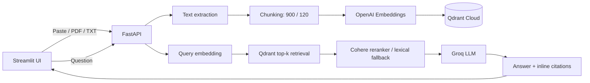

---
title: Mini RAG - AI Engineer Assessment
emoji: 🔎
colorFrom: blue
colorTo: purple
sdk: gradio
sdk_version: "5.12.0"
app_file: app.py
pinned: false
---


# Mini RAG — AI Engineer Assessment

A compact, deployable retrieval-augmented generation application. Users paste text or upload multiple PDF/DOCX/TXT/Markdown/CSV documents, the API chunks and embeds the content, stores vectors and metadata in **Qdrant Cloud**, retrieves the top-k matches, reranks them, and generates an answer grounded in retrieved passages with inline citations.

## Features mapped to the brief

- Hosted vector DB: Qdrant Cloud collection with cosine similarity.
- Embeddings: OpenAI `text-embedding-3-small` (1536 dimensions by default).
- Chunking: 900 whitespace-token chunks with 120-token overlap; configurable by environment.
- Metadata: source, document ID, title, section, PDF page (when extractable), chunk position and deterministic chunk ID stored with every point. Re-indexing a filename replaces only that file; other documents remain indexed.
- Retrieval + reranking: vector top-k search with optional exact `source` filtering; Cohere Rerank v3.5 when configured, combined lexical/vector fallback otherwise. Weak matches below `MIN_RELEVANCE_SCORE` are rejected before generation.
- LLM: official Groq Python SDK (`groq.AsyncGroq`) with the `openai/gpt-oss-120b` model by default (recommended replacement for the deprecated Llama 3.3 70B model on Groq developer/free tiers).
- Grounding: answer prompt requires context-only claims and `[1]`, `[2]` citations; graceful no-evidence response.
- UI: Gradio and Streamlit multi-file upload/paste, all-document search by default, optional source filtering, document listing/deletion, citations/source snippets, timing and token/cost estimates.
- API: FastAPI endpoints and health check.
- Evaluation: five gold Q&A pairs and a small end-to-end evaluator.

## Architecture



## Quick start (Docker)

1. Create a free Qdrant Cloud cluster and copy its HTTPS URL and API key.
2. Copy `.env.example` to `.env` and set `QDRANT_URL`, `QDRANT_API_KEY`, `OPENAI_API_KEY`, and `LLM_API_KEY`. A Groq API key is used by the official Groq Python SDK for LLM generation. Set `COHERE_API_KEY` to enable the Cohere reranker; otherwise the app clearly reports its lexical fallback.
3. Run:

```bash
cp .env.example .env
# Edit .env with your credentials
docker compose up --build
```

4. Open the UI at http://localhost:8501 and API docs at http://localhost:8000/docs.
5. Upload `sample_data/product_handbook.txt` or paste its contents, then ask questions.

The Compose setup runs the API and UI locally while using the **hosted Qdrant Cloud** database. No API keys are sent to the browser.

## Run without Docker

```bash
python -m venv .venv
source .venv/bin/activate
pip install -r requirements.txt
cp .env.example .env
uvicorn app.main:app --reload --port 8000
```

In another terminal:

```bash
source .venv/bin/activate
streamlit run streamlit_app.py
```

## API

- `GET /health` — app/provider configuration status (does not expose secrets).
- `POST /api/ingest` — JSON `{ "text": "...", "source": "manual.txt", "title": "Title", "section": "Optional" }`.
- `POST /api/ingest/file` — multipart file upload. Supports PDF, DOCX, TXT, MD and CSV. Upload multiple files by sending one request per file. Scanned PDFs require OCR and are rejected with a clear message if no text can be extracted.
- `POST /api/query` — JSON `{ "question": "...", "top_k": 12, "source": "optional-exact-filename.pdf" }`. Omit `source` to search all indexed documents.
- `GET /api/documents` — list distinct indexed files and chunk counts.
- `DELETE /api/documents?source=filename.pdf` — delete only the selected file.

## Index / collection configuration

HNSW is enabled by default with conservative settings (`m=16`, `ef_construct=100`, search-time `hnsw_ef=128`). On startup, MiniRAG applies these settings to the existing collection without deleting its vectors. Qdrant may rebuild affected graph segments in the background. Adjust `HNSW_ENABLED`, `HNSW_M`, `HNSW_EF_CONSTRUCT`, and `HNSW_EF` in `.env` for your cluster. For very small collections, Qdrant may choose an exact/full-scan path depending on its segment thresholds; this is normal.

| Setting | Default | Meaning |
|---|---:|---|
| Collection | `minirag_documents` | Qdrant collection name |
| Vector size | `1536` | Must match embedding model output |
| Distance | `Cosine` | Similarity metric |
| Embedding model | `text-embedding-3-small` | OpenAI embedding model |
| Chunk size | `900` | Approximate whitespace-token count per chunk |
| Overlap | `120` | Approximate shared tokens between adjacent chunks |
| Initial top-k | `12` | Vector candidates before reranking |
| Rerank output | `5` | Candidates passed to the LLM |

Point payload schema:

```json
{
  "text": "chunk body",
  "source": "manual.pdf",
  "title": "Manual",
  "section": "Overview",
  "position": 0,
  "chunk_id": "uuid"
}
```

The Qdrant point ID is a deterministic UUID. Each document is identified by its source filename; re-indexing the same filename replaces its previous chunks. Use distinct filenames for distinct documents. Source filtering uses a `KEYWORD` payload index created automatically on startup.

## Evaluation

The gold set in `gold_qa.json` contains five questions based on `sample_data/product_handbook.txt`. After configuring providers and starting the API, ingest the sample document in the UI, then run:

```bash
python evaluate.py
```

The script reports exact-term answer success and expected-source citation rate. These are intentionally simple smoke-test metrics, not a statistically robust benchmark. Record the actual run output in the submission rather than claiming unmeasured scores. For a fuller benchmark, add human-judged answer correctness, retrieval Recall@k/MRR, citation entailment, latency percentiles, and repeated runs.

## Deployment (free-tier friendly)

- **Vector DB:** Qdrant Cloud free tier (availability/limits depend on current plan).
- **Backend:** Render Web Service from this repo, Docker runtime, using `Dockerfile`; configure all secrets as Render environment variables and expose port 8000.
- **Frontend:** Streamlit Community Cloud from this repo, main file `streamlit_app.py`; set `API_URL` to the deployed Render HTTPS URL. Alternatively deploy the UI as a second Docker service.
- Restrict backend CORS to the deployed UI origin before public production use. Add authentication/rate limiting for a public endpoint.

A successful deployment requires provisioning external API keys and a Qdrant Cloud cluster; no live URL is fabricated by this repository. Verify `/health`, upload the sample document, and run all five gold questions after deployment.

## Environment variables

See `.env.example`. Required values are `QDRANT_URL`, `QDRANT_API_KEY`, `OPENAI_API_KEY`, and `LLM_API_KEY`. `LLM_MODEL` selects the Groq model. The official Groq SDK manages the API endpoint; no `LLM_BASE_URL` is needed. Set `LLM_PROVIDER=groq` and provide `LLM_API_KEY` with your Groq API key. Keep all secrets server-side and never commit `.env`.

## Trade-offs, limits and next steps (Remarks)

1. Chunk size uses whitespace-token approximation rather than model-specific tokenization. Replace with `tiktoken` or the embedding model tokenizer for exact token limits.
2. Cohere reranking is optional. The fallback uses lexical query-term overlap, which is deterministic and credential-free but less semantically capable than a neural reranker.
3. The cost figure is a rough illustrative LLM estimate and excludes embeddings/reranking. Provider pricing and model rates change; use provider usage/billing for authoritative cost.
4. PDF page numbers are captured from extracted `[Page N]` markers when present. A chunk spanning multiple pages currently records the first page marker found in that chunk.
5. No authentication, tenant isolation, OCR, streaming, or async background ingestion is included in this time-boxed starter. The document deletion endpoint is intended for a single-user collection; add tenant scoping before multi-user deployment.
6. Improve observability with structured logs, OpenTelemetry, request IDs, retry/backoff, and provider-specific usage accounting.
7. Before production: lock down CORS, add API auth/rate limiting, validate file types/content, configure Qdrant backups, and add an evaluation set reflecting real user documents.

## Tests

```bash
pytest -q
```

## Suggested resume link

After publishing the repository, add its public GitHub URL and deployed frontend/backend URLs to your resume/application. Replace this sentence with your actual links; do not submit placeholder URLs.


## LangSmith observability

This project instruments the RAG pipeline with LangSmith `@traceable` spans:
- `rag_query` (end-to-end request)
- `retrieve_documents` (Qdrant vector retrieval)
- `rerank_documents` (Cohere or local lexical fallback)
- `generate_grounded_answer` (Groq generation)
- `embed_documents` and `ingest_document` (embedding and ingestion)

Configure these variables in `.env` to enable tracing (current LangSmith environment variable names):

```env
LANGSMITH_TRACING=true
LANGSMITH_API_KEY=lsv2_your-langsmith-api-key
LANGSMITH_PROJECT=mini-rag-assessment
LANGSMITH_ENDPOINT=https://api.smith.langchain.com
```

The settings loader also accepts the older `LANGCHAIN_*` aliases. LangSmith tracing is initialized from the settings loaded out of `.env`, so local runs and Docker `env_file` runs use the same configuration.

### Run a LangSmith evaluation

The `evaluate_langsmith.py` script creates the `mini-rag-gold-qa` dataset from `gold_qa.json` if it does not already exist, then evaluates the live API and uploads per-example feedback to LangSmith. It measures expected-term coverage, expected-source citation, presence of citations, and whether end-to-end latency is at or below 5 seconds. These are deterministic smoke-test checks, not an LLM-as-judge assessment of semantic correctness or citation entailment.

1. Start the stack and ingest `sample_data/product_handbook.txt` through the UI.
2. Ensure `.env` contains a valid `LANGSMITH_API_KEY` and `LANGSMITH_TRACING=true`.
3. Run `python evaluate_langsmith.py` from the project directory.
4. Open LangSmith → Datasets / Experiments and inspect the `mini-rag-gold-qa` dataset and the `mini-rag-baseline` experiment.

Set `LANGSMITH_DATASET` to use a different dataset name, or `API_URL` if the backend is not at `http://localhost:8000`. Existing datasets are not overwritten or silently reseeded; add/update examples in the LangSmith UI or delete/recreate the dataset intentionally when the gold set changes.

Create a project/API key in [LangSmith](https://smith.langchain.com/). Restart the API after changing `.env`.
When tracing is disabled or no API key is set, the application continues to run without LangSmith traces.
The `/health` response reports whether tracing is configured; it does not expose credentials.


## Retrieval changes for small/free Qdrant clusters

- Qdrant payload filtering is used to restrict a query to an exact source filename when requested; this does not require a paid plan.
- On startup, MiniRAG checks the configured collection and creates a Qdrant `KEYWORD` payload index for `source` if it is missing. This fixes Qdrant 400 errors about `Index required but not found for "source"`; existing vectors are preserved.
- In the Gradio chat tab, enter the indexed filename in **Optional source filename filter** to search only that document. Leave it blank to search the full collection.
- Re-indexing a file with the same `source` filename first removes its old points, then writes the new chunks. Use distinct source filenames if you intend to keep two separate versions.
- `MIN_RELEVANCE_SCORE=0.18` is a starting threshold, not a universal value. Tune it using your evaluation questions and observed reranker scores.
- Existing indexed points are not automatically deleted by this update. Re-upload/re-index a document to replace that source's points.
