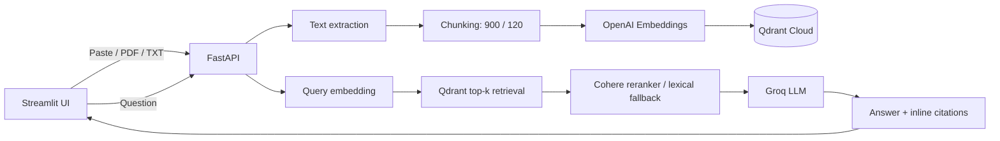

---title: Mini RAG - AI Engineer Assessment
emoji: 🔎
colorFrom: blue
colorTo: purple
sdk: gradio
sdk_version: "5.12.0"
app_file: app.py
pinned: false---

---
title: Mini RAG - AI Engineer Assessment
emoji: 🔎
colorFrom: blue
colorTo: purple
sdk: gradio
sdk_version: "5.12.0"
app_file: app.py
pinned: false

---

# Mini RAG — AI Engineer Assessment

A compact, deployable retrieval-augmented generation application. Users paste text or upload multiple PDF/DOCX/TXT/Markdown/CSV documents, the API chunks and embeds the content, stores vectors and metadata in **Qdrant Cloud**, retrieves the top-k matches, reranks them, and generates an answer grounded in retrieved passages with inline citations.

## Features mapped to the brief

- Hosted vector DB: Qdrant Cloud collection with cosine similarity.
- Embeddings: OpenAI `text-embedding-3-small` (1536 dimensions by default).
- Chunking: 900 whitespace-token chunks with 120-token overlap; configurable by environment.
- Metadata: source, document ID, title, section, PDF page (when extractable), chunk position and deterministic chunk ID stored with every point. Re-indexing a filename replaces only that file; other documents remain indexed.
- Retrieval + reranking: vector top-k search with optional exact `source` filtering; Cohere Rerank v3.5 when configured, combined lexical/vector fallback otherwise. Weak matches below `MIN_RELEVANCE_SCORE` are rejected before generation.
- LLM: official Groq Python SDK (`groq.AsyncGroq`) with the `openai/gpt-oss-120b` model by default (recommended replacement for the deprecated Llama 3.3 70B model on Groq developer/free tiers).
- Grounding: answer prompt requires context-only claims and `[1]`, `[2]` citations; graceful no-evidence response.
- UI: Gradio and Streamlit multi-file upload/paste, all-document search by default, optional source filtering, document listing/deletion, citations/source snippets, timing and token/cost estimates.
- API: FastAPI endpoints and health check.
- Evaluation: five gold Q&A pairs and a small end-to-end evaluator.

## Architecture



## Quick start (Docker)

1. Create a free Qdrant Cloud cluster and copy its HTTPS URL and API key.
2. Copy `.env.example` to `.env` and set `QDRANT_URL`, `QDRANT_API_KEY`, `OPENAI_API_KEY`, and `LLM_API_KEY`. A Groq API key is used by the official Groq Python SDK for LLM generation. Set `COHERE_API_KEY` to enable the Cohere reranker; otherwise the app clearly reports its lexical fallback.
3. Run:

```bash
cp .env.example .env
# Edit .env with your credentials
docker compose up --build
```

4. Open the UI at http://localhost:8501 and API docs at http://localhost:8000/docs.
5. Upload `sample_data/product_handbook.txt` or paste its contents, then ask questions.

The Compose setup runs the API and UI locally while using the **hosted Qdrant Cloud** database. No API keys are sent to the browser.

## Run without Docker

```bash
python -m venv .venv
source .venv/bin/activate
pip install -r requirements.txt
cp .env.example .env
uvicorn app.main:app --reload --port 8000
```

In another terminal:

```bash
source .venv/bin/activate
streamlit run streamlit_app.py
```

## API

- `GET /health` — app/provider configuration status (does not expose secrets).
- `POST /api/ingest` — JSON `{ "text": "...", "source": "manual.txt", "title": "Title", "section": "Optional" }`.
- `POST /api/ingest/file` — multipart file upload. Supports PDF, DOCX, TXT, MD and CSV. Upload multiple files by sending one request per file. Scanned PDFs require OCR and are rejected with a clear message if no text can be extracted.
- `POST /api/query` — JSON `{ "question": "...", "top_k": 12, "source": "optional-exact-filename.pdf" }`. Omit `source` to search all indexed documents.
- `GET /api/documents` — list distinct indexed files and chunk counts.
- `DELETE /api/documents?source=filename.pdf` — delete only the selected file.

## Index / collection configuration

HNSW is enabled by default with conservative settings (`m=16`, `ef_construct=100`, search-time `hnsw_ef=128`). On startup, MiniRAG applies these settings to the existing collection without deleting its vectors. Qdrant may rebuild affected graph segments in the background. Adjust `HNSW_ENABLED`, `HNSW_M`, `HNSW_EF_CONSTRUCT`, and `HNSW_EF` in `.env` for your cluster. For very small collections, Qdrant may choose an exact/full-scan path depending on its segment thresholds; this is normal.

| Setting | Default | Meaning |
|---|---:|---|
| Collection | `minirag_documents` | Qdrant collection name |
| Vector size | `1536` | Must match embedding model output |
| Distance | `Cosine` | Similarity metric |
| Embedding model | `text-embedding-3-small` | OpenAI embedding model |
| Chunk size | `900` | Approximate whitespace-token count per chunk |
| Overlap | `120` | Approximate shared tokens between adjacent chunks |
| Initial top-k | `12` | Vector candidates before reranking |
| Rerank output | `5` | Candidates passed to the LLM |

Point payload schema:

```json
{
  "text": "chunk body",
  "source": "manual.pdf",
  "title": "Manual",
  "section": "Overview",
  "position": 0,
  "chunk_id": "uuid"
}
```

The Qdrant point ID is a deterministic UUID. Each document is identified by its source filename; re-indexing the same filename replaces its previous chunks. Use distinct filenames for distinct documents. Source filtering uses a `KEYWORD` payload index created automatically on startup.

## Evaluation

The gold set in `gold_qa.json` contains five questions based on `sample_data/product_handbook.txt`. After configuring providers and starting the API, ingest the sample document in the UI, then run:

```bash
python evaluate.py
```

The script reports exact-term answer success and expected-source citation rate. These are intentionally simple smoke-test metrics, not a statistically robust benchmark. Record the actual run output in the submission rather than claiming unmeasured scores. For a fuller benchmark, add human-judged answer correctness, retrieval Recall@k/MRR, citation entailment, latency percentiles, and repeated runs.

## Deployment (free-tier friendly)

- **Vector DB:** Qdrant Cloud free tier (availability/limits depend on current plan).
- **Backend:** Render Web Service from this repo, Docker runtime, using `Dockerfile`; configure all secrets as Render environment variables and expose port 8000.
- **Frontend:** Streamlit Community Cloud from this repo, main file `streamlit_app.py`; set `API_URL` to the deployed Render HTTPS URL. Alternatively deploy the UI as a second Docker service.
- Restrict backend CORS to the deployed UI origin before public production use. Add authentication/rate limiting for a public endpoint.

A successful deployment requires provisioning external API keys and a Qdrant Cloud cluster; no live URL is fabricated by this repository. Verify `/health`, upload the sample document, and run all five gold questions after deployment.

## Environment variables

See `.env.example`. Required values are `QDRANT_URL`, `QDRANT_API_KEY`, `OPENAI_API_KEY`, and `LLM_API_KEY`. `LLM_MODEL` selects the Groq model. The official Groq SDK manages the API endpoint; no `LLM_BASE_URL` is needed. Set `LLM_PROVIDER=groq` and provide `LLM_API_KEY` with your Groq API key. Keep all secrets server-side and never commit `.env`.

## Trade-offs, limitations, and next steps

1. Chunk size uses whitespace-token approximation rather than model-specific tokenization. Replace with `tiktoken` or the embedding model tokenizer for exact token limits.
2. Cohere reranking is optional. The fallback uses lexical query-term overlap, which is deterministic and credential-free but less semantically capable than a neural reranker.
3. The cost figure is a rough illustrative LLM estimate and excludes embeddings/reranking. Provider pricing and model rates change; use provider usage/billing for authoritative cost.
4. PDF page numbers are captured from extracted `[Page N]` markers when present. A chunk spanning multiple pages currently records the first page marker found in that chunk.
5. No authentication, tenant isolation, OCR, streaming, or async background ingestion is included in this time-boxed starter. The document deletion endpoint is intended for a single-user collection; add tenant scoping before multi-user deployment.
6. Improve observability with structured logs, OpenTelemetry, request IDs, retry/backoff, and provider-specific usage accounting.
7. Before production: lock down CORS, add API auth/rate limiting, validate file types/content, configure Qdrant backups, and add an evaluation set reflecting real user documents.

## Example technical questions

The project has been exercised with questions covering:
- The purpose of `malloc()` in C.
- IPv4 address classes A, B, C, D, and E.
- The seven layers of the OSI model.
- `calloc()` and `malloc()`.
- The difference between TCP and UDP.

## Tests

```bash
pytest -q
```

## Suggested resume link

After publishing the repository, add its public GitHub URL and deployed frontend/backend URLs to your resume/application. Replace this sentence with your actual links; do not submit placeholder URLs.

## LangSmith observability

This project instruments the RAG pipeline with LangSmith `@traceable` spans:
- `rag_query` (end-to-end request)
- `retrieve_documents` (Qdrant vector retrieval)
- `rerank_documents` (Cohere or local lexical fallback)
- `generate_grounded_answer` (Groq generation)
- `embed_documents` and `ingest_document` (embedding and ingestion)

Configure these variables in `.env` to enable tracing (current LangSmith environment variable names):

```env
LANGSMITH_TRACING=true
LANGSMITH_API_KEY=lsv2_your-langsmith-api-key
LANGSMITH_PROJECT=mini-rag-assessment
LANGSMITH_ENDPOINT=https://api.smith.langchain.com
```

The settings loader also accepts the older `LANGCHAIN_*` aliases. LangSmith tracing is initialized from the settings loaded out of `.env`, so local runs and Docker `env_file` runs use the same configuration.

### Run a LangSmith evaluation

The `evaluate_langsmith.py` script creates the `mini-rag-gold-qa` dataset from `gold_qa.json` if it does not already exist, then evaluates the live API and uploads per-example feedback to LangSmith. It measures expected-term coverage, expected-source citation, presence of citations, and whether end-to-end latency is at or below 5 seconds. These are deterministic smoke-test checks, not an LLM-as-judge assessment of semantic correctness or citation entailment.

1. Start the stack and ingest `sample_data/product_handbook.txt` through the UI.
2. Ensure `.env` contains a valid `LANGSMITH_API_KEY` and `LANGSMITH_TRACING=true`.
3. Run `python evaluate_langsmith.py` from the project directory.
4. Open LangSmith → Datasets / Experiments and inspect the `mini-rag-gold-qa` dataset and the `mini-rag-baseline` experiment.

Set `LANGSMITH_DATASET` to use a different dataset name, or `API_URL` if the backend is not at `http://localhost:8000`. Existing datasets are not overwritten or silently reseeded; add/update examples in the LangSmith UI or delete/recreate the dataset intentionally when the gold set changes.

Create a project/API key in [LangSmith](https://smith.langchain.com/). Restart the API after changing `.env`.
When tracing is disabled or no API key is set, the application continues to run without LangSmith traces.
The `/health` response reports whether tracing is configured; it does not expose credentials.

## Retrieval changes for small/free Qdrant clusters

- Qdrant payload filtering is used to restrict a query to an exact source filename when requested; this does not require a paid plan.
- On startup, MiniRAG checks the configured collection and creates a Qdrant `KEYWORD` payload index for `source` if it is missing. This fixes Qdrant 400 errors about `Index required but not found for "source"`; existing vectors are preserved.
- In the Gradio chat tab, enter the indexed filename in **Optional source filename filter** to search only that document. Leave it blank to search the full collection.
- Re-indexing a file with the same `source` filename first removes its old points, then writes the new chunks. Use distinct source filenames if you intend to keep two separate versions.
- `MIN_RELEVANCE_SCORE=0.18` is a starting threshold, not a universal value. Tune it using your evaluation questions and observed reranker scores.
- Existing indexed points are not automatically deleted by this update. Re-upload/re-index a document to replace that source's points.

## System limitations, trade-offs, and improvement roadmap

## 1. Current System Limitations

The MiniRAG project uses document ingestion, embeddings, Qdrant vector search, hybrid retrieval, Cohere reranking, and Groq-powered answer generation.

### A. Document Ingestion
- Poor chunking can split important technical explanations across multiple chunks.
- Large chunks may contain irrelevant information.
- Small chunks may lose the context needed to answer a question.
- Missing or incorrect page metadata can produce inaccurate citations.

### B. Embedding and Vector Search
- Dense retrieval may fail to retrieve exact technical terms, identifiers, IP addresses, or uncommon keywords.
- Semantically similar chunks are not always factually relevant.
- Retrieval quality depends heavily on the embedding model.
- Changing the embedding model without re-indexing can make existing vectors incompatible.

### C. Hybrid Retrieval
- Combining dense retrieval and BM25 improves coverage but adds computational overhead.
- Reciprocal Rank Fusion (RRF) depends on the quality of the individual rankings.
- BM25 may struggle with semantic questions that use different wording from the source.
- Loading all Qdrant documents into memory for BM25 is not scalable for large collections.

### D. Reranking
- Cohere reranking introduces additional latency and API cost.
- Reranking cannot recover relevant documents that were never retrieved.
- Poor-quality initial candidates can still produce poor final results.
- API limits and network failures can affect reliability.

### E. LLM Answer Generation
- Groq generation can still produce unsupported statements if retrieved context is insufficient.
- Long context increases token usage and latency.
- Incorrect or incomplete retrieval can lead to hallucinations.
- Citations may be incorrect unless they are explicitly validated against retrieved chunks.

### F. Infrastructure and Performance
- External embedding, reranking, and LLM APIs introduce network latency.
- Qdrant Cloud performance depends on the deployment and available resources.
- Free-tier services may have resource and usage limitations.
- End-to-end latency can increase as retrieval and reranking stages become more complex.

## 2. Key Trade-offs

| Component | Current Approach | Advantage | Trade-off |
|---|---|---|---|
| Embeddings | Sentence Transformers / local embeddings | Lower recurring API cost | Local compute and memory requirements |
| Vector database | Qdrant Cloud | Managed vector search | Network latency and service limits |
| Keyword retrieval | BM25 | Better exact keyword matching | Additional indexing and computation |
| Hybrid retrieval | Dense + BM25 + RRF | Better retrieval coverage | More complexity and latency |
| Reranking | Cohere | Better candidate relevance | API cost and additional latency |
| LLM | Groq | Fast inference | External API dependency and token limits |
| Frontend | Streamlit / Gradio | Fast development | Less control over complex production UI |
| Backend | FastAPI | API separation and scalability | Deployment and monitoring complexity |

## 3. What Should Be Improved Next?

### Priority 1 — Build a Retrieval Evaluation Dataset

Create a dataset of 30–50 questions with:
- Question
- Expected answer
- Expected source document
- Expected page number
- Relevant chunk IDs

Include different question types:
- Exact keyword questions: What is malloc?
- Conceptual questions: Explain dynamic memory allocation.
- Comparison questions: Difference between TCP and UDP.
- Technical questions: What are the IPv4 address classes?
- Multi-part questions requiring information from multiple chunks.

**Why:** You need measurable evidence that retrieval improvements are actually working.

### Priority 2 — Measure Retrieval Quality

Evaluate the following metrics:

| Metric | Purpose |
|---|---|
| Recall@5 | Whether relevant chunks appear in the top five |
| Recall@10 | Whether relevant chunks appear in the top ten |
| MRR | How highly the first relevant result is ranked |
| nDCG@10 | Quality of the ranking across the top ten |
| Precision@5 | How many retrieved chunks are relevant |

Compare three retrieval approaches:

1. Dense retrieval only.
2. BM25 retrieval only.
3. Hybrid retrieval using RRF.

**Target:** Hybrid retrieval should improve retrieval quality without causing unacceptable latency.

### Priority 3 — Improve Chunking

Experiment with:
- 300-token chunks.
- 500-token chunks.
- 700-token chunks.
- 10–20% overlap.
- Section-aware chunking.

Preserve:
- Document title.
- Section heading.
- Page number.
- Source filename.
- Chunk ID.

Choose the configuration that produces the best evaluation results.

### Priority 4 — Optimize Reranking

Test:
- Top 10 candidates.
- Top 20 candidates.
- Top 30 candidates.

Measure:
- Reranking latency.
- Retrieval quality before reranking.
- Retrieval quality after reranking.
- API cost.

Remember: reranking improves candidate ordering; it cannot find a relevant chunk that the retrieval stage missed.

### Priority 5 — Add Grounding and Citation Validation

Implement these checks:

1. Generate answers only from retrieved context.
2. Require citations for factual claims.
3. Verify cited chunk IDs exist.
4. Verify page numbers against document metadata.
5. Return an insufficient-context response when evidence is unavailable.
6. Avoid generating unsupported answers.

### Priority 6 — Improve Performance and Scalability

- Cache document embeddings and repeated queries where appropriate.
- Avoid loading the entire Qdrant collection into memory for every retrieval operation.
- Consider Qdrant sparse vectors or a dedicated BM25 index for larger datasets.
- Use asynchronous API calls where appropriate.
- Add timeouts and retries for external services.
- Measure latency separately for embedding, retrieval, reranking, and generation.

## 4. Recommended Evaluation Targets

These are proposed engineering targets, not measured results.

| Metric | Initial Target |
|---|---:|
| Recall@5 | ≥ 80% |
| Recall@10 | ≥ 90% |
| MRR | ≥ 0.70 |
| Citation validity | ≥ 95% |
| Grounded answer accuracy | ≥ 90% |
| End-to-end response time | ≤ 2 seconds where feasible |

Measure actual performance before claiming these targets have been achieved.

## 5. Recommended Implementation Roadmap

| Phase | Work | Priority |
|---|---|---|
| 1 | Build 30–50 question evaluation dataset | Critical |
| 2 | Compare dense, BM25, and hybrid retrieval | Critical |
| 3 | Optimize chunking and metadata | High |
| 4 | Tune Cohere reranking | High |
| 5 | Add answer grounding and citation validation | Critical |
| 6 | Optimize latency and caching | High |
| 7 | Add monitoring, logging, and error handling | Medium |
| 8 | Deploy and run production-style tests | Medium |

## 6. What I Recommend Doing Next

Do not add more components yet. First establish whether your existing retrieval pipeline returns the correct evidence.

**Recommended immediate task: Build a MiniRAG evaluation framework.**

It should automatically:
1. Load the 30–50 test questions.
2. Query the MiniRAG API.
3. Record retrieved chunks and their rankings.
4. Compare retrieved chunks against expected relevant chunks.
5. Calculate Recall@5, Recall@10, MRR, and nDCG@10.
6. Measure end-to-end latency.
7. Export results to CSV.
8. Compare dense-only, BM25-only, and hybrid retrieval.

**Final objective:** Turn MiniRAG from a working document chatbot into an evaluated, measurable, reliable RAG system.

## Architecture schema: Track A and Track B

## 1. Clear Schema (Project Architecture)

MiniRAG follows a modular Retrieval-Augmented Generation (RAG) architecture. Each component has a clearly defined responsibility.

### End-to-End Workflow

Document Upload → Document Parsing → Text Cleaning → Chunking → Metadata Extraction → Embedding Generation → Qdrant Storage → Query Processing → Hybrid Retrieval → Reranking → Context Preparation → Groq LLM → Answer Generation → Citation Validation → Response

### Component Responsibilities

| Component | Responsibility |
|---|---|
| Streamlit / Gradio | User interface and document upload |
| FastAPI | Backend API and request handling |
| Document Parser | Extract text from PDF and supported files |
| Chunking Module | Split documents into manageable text segments |
| Metadata Module | Store source filename, page number, and chunk ID |
| Embedding Model | Convert text into vector representations |
| Qdrant | Store and retrieve document vectors |
| BM25 | Retrieve documents using keyword matching |
| RRF | Combine dense and keyword retrieval rankings |
| Cohere Reranker | Reorder retrieved chunks by relevance |
| Groq LLM | Generate answers from retrieved context |
| Citation Validator | Validate source and page references |
| LangSmith | Trace and monitor application execution |

### Data Schema

**Document Schema**

- document_id: Unique document identifier
- filename: Original document filename
- file_type: Document format
- uploaded_at: Upload timestamp
- status: Processing status

**Chunk Schema**

- chunk_id: Unique chunk identifier
- document_id: Parent document identifier
- source: Original filename
- page_number: Physical PDF page number
- chunk_index: Position within the document
- text: Extracted chunk content
- embedding: Vector representation
- metadata: Additional document information

**Query Schema**

- query_id: Unique query identifier
- question: User question
- source: Optional document filter
- top_k: Number of retrieval candidates
- retrieved_chunks: Retrieved evidence
- reranked_chunks: Reranked evidence
- answer: Generated response
- citations: Source and page references
- latency_ms: End-to-end response time

---

## 2. Track A — Clear Schema and Data Pipeline

**Objective:** Ensure that document ingestion, metadata, storage, and retrieval follow a consistent structure.

### Track A Tasks

1. Define document and chunk schemas.
2. Implement document parsing.
3. Implement text cleaning and normalization.
4. Implement configurable chunking.
5. Preserve page numbers and source metadata.
6. Generate embeddings using a consistent model.
7. Store vectors and metadata in Qdrant.
8. Implement document-level filtering.
9. Validate metadata during ingestion.
10. Add duplicate document detection.

### Track A Deliverables

- Document schema.
- Chunk schema.
- Metadata validation.
- Consistent ingestion pipeline.
- Qdrant collection configuration.
- Document-level retrieval.
- Ingestion error handling.

### Track A Success Criteria

- Every chunk has a valid chunk ID.
- Every chunk has a source filename.
- Page metadata is preserved.
- Embedding dimensions are consistent.
- Retrieval returns the correct source document.
- Re-ingestion does not silently create unwanted duplicates.

---

## 3. Track B — Index Configuration and Retrieval Optimization

**Objective:** Configure and optimize indexing and retrieval so MiniRAG retrieves relevant evidence accurately and efficiently.

### Track B Tasks

**A. Embedding Configuration**

- Configure embedding provider.
- Configure embedding model.
- Record embedding dimensions.
- Ensure query and document embeddings use the same model.
- Re-index documents if the embedding model changes.

**B. Qdrant Index Configuration**

- Define collection name.
- Configure vector dimensions.
- Configure distance metric, such as cosine similarity.
- Configure payload indexes for frequently filtered metadata.
- Configure storage and retrieval settings.
- Validate collection compatibility before ingestion.

**C. Retrieval Configuration**

- Configure dense retrieval top-k.
- Configure BM25 retrieval top-k.
- Combine rankings using Reciprocal Rank Fusion (RRF).
- Configure source filtering.
- Remove duplicate chunks.
- Return retrieval scores and diagnostic information.

**D. Reranking Configuration**

- Configure Cohere reranker.
- Define candidate count.
- Define final context count.
- Compare retrieval rankings before and after reranking.
- Measure reranking latency and API usage.

**E. Generation Configuration**

- Configure Groq model.
- Set temperature.
- Set maximum output tokens.
- Define grounding instructions.
- Require citations for factual answers.
- Return an insufficient-evidence response when necessary.

### Track B Configuration Table

| Setting | Configuration |
|---|---|
| Vector database | Qdrant |
| Embedding provider | Local or configured provider |
| Embedding model | Configurable |
| Vector dimension | Must match embedding model |
| Distance metric | Cosine |
| Keyword retrieval | BM25 |
| Hybrid fusion | RRF |
| Reranker | Cohere |
| LLM provider | Groq |
| Tracing | LangSmith |
| Retrieval top-k | Configurable |
| Reranking top-k | Configurable |
| Final context count | Configurable |

### Track B Success Criteria

- Dense retrieval returns semantically relevant chunks.
- BM25 retrieves exact technical terms.
- Hybrid retrieval improves retrieval coverage.
- Reranking improves the ordering of relevant chunks.
- Source filtering returns only the requested document.
- Embedding configuration remains consistent between indexing and querying.
- Retrieval and generation latency are measured separately.

---

## 4. Track A vs Track B

| Area | Track A | Track B |
|---|---|---|
| Main focus | Data and schema consistency | Indexing and retrieval configuration |
| Document parsing | Yes | No |
| Chunking | Yes | Configuration impact |
| Metadata | Yes | Metadata filtering |
| Embeddings | Generate and store | Configure and validate |
| Qdrant | Store documents | Configure indexes and search |
| BM25 | No | Yes |
| RRF | No | Yes |
| Cohere reranking | No | Yes |
| Main output | Reliable document data | Relevant retrieved evidence |

## 5. Recommended Execution Order

1. Complete Track A schemas and ingestion validation.
2. Verify Qdrant document and chunk metadata.
3. Complete Track B embedding and collection configuration.
4. Implement dense retrieval.
5. Implement BM25 retrieval.
6. Implement RRF hybrid retrieval.
7. Integrate Cohere reranking.
8. Add source filtering.
9. Validate citations and page numbers.
10. Run retrieval evaluation and latency benchmarks.

## Final Objective

**Track A ensures that MiniRAG stores clean, structured, traceable document data.**

**Track B ensures that MiniRAG indexes that data correctly and retrieves the most relevant evidence for each question.**

Together, these tracks establish a reliable foundation for an accurate, scalable, and production-ready MiniRAG system.

## Recorded evaluation snapshot

<details>
<summary>Evaluation run details — 2026-11-26T19:41:07.686118+00:00</summary>

| Metric | Recorded value |
|---|---:|
| Questions | 5 |
| Successful queries | 5 |
| Failed queries | 0 |
| Average client latency | 14565.27 ms |
| Average retrieval latency | 10962.76 ms |
| Average reranking latency | 945.44 ms |
| Average generation latency | 2647.48 ms |
| Answer precision (token-overlap baseline) | 0.19 |
| Answer recall (token-overlap baseline) | 0.6466 |
| Answer F1 (token-overlap baseline) | 0.2937 |
| Retrieval metrics | Not evaluated: relevant chunk IDs not labelled. |

### Per-question results

| ID | Question | Source supported | Status | Client latency (ms) | Citations |
|---|---|:---:|---|---:|---:|
| Q1 | What is the purpose of malloc() in C? | Yes | success | 24,707 | 3 |
| Q2 | Explain the five IPv4 address classes: A, B, C, D, and E. | No | success | 13,373 | 3 |
| Q3 | What are the seven layers of the OSI model? | No | success | 10,670 | 3 |
| Q4 | What is the difference between TCP and UDP? | No | success | 9,799 | 3 |
| Q5 | What is a pointer? | Yes | success | 14,276 | 3 |

**Interpretation:** These are recorded smoke-test results, not a semantic accuracy benchmark. Token-overlap metrics do not establish factual correctness or faithfulness. Retrieval metrics were not calculated because relevant chunk IDs had not been labelled.

</details>

resume :https://drive.google.com/file/d/13C9XJDfzTywamtTJ1PXXgIy_MknUZ6f-/view?usp=sharing
