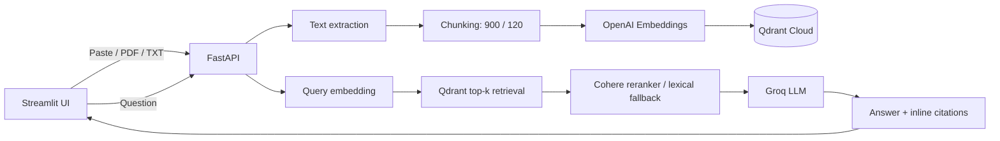

---
title: Mini RAG - AI Engineer Assessment
emoji: 🔎
colorFrom: blue
colorTo: purple
sdk: gradio
sdk_version: "5.12.0"
app_file: app.py
pinned: false
---


# Mini RAG — AI Engineer Assessment

A compact, deployable retrieval-augmented generation application. Users paste text or upload multiple PDF/DOCX/TXT/Markdown/CSV documents, the API chunks and embeds the content, stores vectors and metadata in **Qdrant Cloud**, retrieves the top-k matches, reranks them, and generates an answer grounded in retrieved passages with inline citations.

## Features mapped to the brief

- Hosted vector DB: Qdrant Cloud collection with cosine similarity.
- Embeddings: OpenAI `text-embedding-3-small` (1536 dimensions by default).
- Chunking: 900 whitespace-token chunks with 120-token overlap; configurable by environment.
- Metadata: source, document ID, title, section, PDF page (when extractable), chunk position and deterministic chunk ID stored with every point. Re-indexing a filename replaces only that file; other documents remain indexed.
- Retrieval + reranking: vector top-k search with optional exact `source` filtering; Cohere Rerank v3.5 when configured, combined lexical/vector fallback otherwise. Weak matches below `MIN_RELEVANCE_SCORE` are rejected before generation.
- LLM: official Groq Python SDK (`groq.AsyncGroq`) with the `openai/gpt-oss-120b` model by default (recommended replacement for the deprecated Llama 3.3 70B model on Groq developer/free tiers).
- Grounding: answer prompt requires context-only claims and `[1]`, `[2]` citations; graceful no-evidence response.
- UI: Gradio and Streamlit multi-file upload/paste, all-document search by default, optional source filtering, document listing/deletion, citations/source snippets, timing and token/cost estimates.
- API: FastAPI endpoints and health check.
- Evaluation: five gold Q&A pairs and a small end-to-end evaluator.

## Architecture



## Quick start (Docker)

1. Create a free Qdrant Cloud cluster and copy its HTTPS URL and API key.
2. Copy `.env.example` to `.env` and set `QDRANT_URL`, `QDRANT_API_KEY`, `OPENAI_API_KEY`, and `LLM_API_KEY`. A Groq API key is used by the official Groq Python SDK for LLM generation. Set `COHERE_API_KEY` to enable the Cohere reranker; otherwise the app clearly reports its lexical fallback.
3. Run:

```bash
cp .env.example .env
# Edit .env with your credentials
docker compose up --build
```

4. Open the UI at http://localhost:8501 and API docs at http://localhost:8000/docs.
5. Upload `sample_data/product_handbook.txt` or paste its contents, then ask questions.

The Compose setup runs the API and UI locally while using the **hosted Qdrant Cloud** database. No API keys are sent to the browser.

## Run without Docker

```bash
python -m venv .venv
source .venv/bin/activate
pip install -r requirements.txt
cp .env.example .env
uvicorn app.main:app --reload --port 8000
```

In another terminal:

```bash
source .venv/bin/activate
streamlit run streamlit_app.py
```

## API

- `GET /health` — app/provider configuration status (does not expose secrets).
- `POST /api/ingest` — JSON `{ "text": "...", "source": "manual.txt", "title": "Title", "section": "Optional" }`.
- `POST /api/ingest/file` — multipart file upload. Supports PDF, DOCX, TXT, MD and CSV. Upload multiple files by sending one request per file. Scanned PDFs require OCR and are rejected with a clear message if no text can be extracted.
- `POST /api/query` — JSON `{ "question": "...", "top_k": 12, "source": "optional-exact-filename.pdf" }`. Omit `source` to search all indexed documents.
- `GET /api/documents` — list distinct indexed files and chunk counts.
- `DELETE /api/documents?source=filename.pdf` — delete only the selected file.

## Index / collection configuration

HNSW is enabled by default with conservative settings (`m=16`, `ef_construct=100`, search-time `hnsw_ef=128`). On startup, MiniRAG applies these settings to the existing collection without deleting its vectors. Qdrant may rebuild affected graph segments in the background. Adjust `HNSW_ENABLED`, `HNSW_M`, `HNSW_EF_CONSTRUCT`, and `HNSW_EF` in `.env` for your cluster. For very small collections, Qdrant may choose an exact/full-scan path depending on its segment thresholds; this is normal.

| Setting | Default | Meaning |
|---|---:|---|
| Collection | `minirag_documents` | Qdrant collection name |
| Vector size | `1536` | Must match embedding model output |
| Distance | `Cosine` | Similarity metric |
| Embedding model | `text-embedding-3-small` | OpenAI embedding model |
| Chunk size | `900` | Approximate whitespace-token count per chunk |
| Overlap | `120` | Approximate shared tokens between adjacent chunks |
| Initial top-k | `12` | Vector candidates before reranking |
| Rerank output | `5` | Candidates passed to the LLM |

Point payload schema:

```json
{
  "text": "chunk body",
  "source": "manual.pdf",
  "title": "Manual",
  "section": "Overview",
  "position": 0,
  "chunk_id": "uuid"
}
```

The Qdrant point ID is a deterministic UUID. Each document is identified by its source filename; re-indexing the same filename replaces its previous chunks. Use distinct filenames for distinct documents. Source filtering uses a `KEYWORD` payload index created automatically on startup.

## Evaluation

The gold set in `gold_qa.json` contains five questions based on `sample_data/product_handbook.txt`. After configuring providers and starting the API, ingest the sample document in the UI, then run:

```bash
python evaluate.py
```

The script reports exact-term answer success and expected-source citation rate. These are intentionally simple smoke-test metrics, not a statistically robust benchmark. Record the actual run output in the submission rather than claiming unmeasured scores. For a fuller benchmark, add human-judged answer correctness, retrieval Recall@k/MRR, citation entailment, latency percentiles, and repeated runs.

## Deployment (free-tier friendly)

- **Vector DB:** Qdrant Cloud free tier (availability/limits depend on current plan).
- **Backend:** Render Web Service from this repo, Docker runtime, using `Dockerfile`; configure all secrets as Render environment variables and expose port 8000.
- **Frontend:** Streamlit Community Cloud from this repo, main file `streamlit_app.py`; set `API_URL` to the deployed Render HTTPS URL. Alternatively deploy the UI as a second Docker service.
- Restrict backend CORS to the deployed UI origin before public production use. Add authentication/rate limiting for a public endpoint.

A successful deployment requires provisioning external API keys and a Qdrant Cloud cluster; no live URL is fabricated by this repository. Verify `/health`, upload the sample document, and run all five gold questions after deployment.

## Environment variables

See `.env.example`. Required values are `QDRANT_URL`, `QDRANT_API_KEY`, `OPENAI_API_KEY`, and `LLM_API_KEY`. `LLM_MODEL` selects the Groq model. The official Groq SDK manages the API endpoint; no `LLM_BASE_URL` is needed. Set `LLM_PROVIDER=groq` and provide `LLM_API_KEY` with your Groq API key. Keep all secrets server-side and never commit `.env`.

## Trade-offs, limits and next steps (Remarks)

1. Chunk size uses whitespace-token approximation rather than model-specific tokenization. Replace with `tiktoken` or the embedding model tokenizer for exact token limits.
2. Cohere reranking is optional. The fallback uses lexical query-term overlap, which is deterministic and credential-free but less semantically capable than a neural reranker.
3. The cost figure is a rough illustrative LLM estimate and excludes embeddings/reranking. Provider pricing and model rates change; use provider usage/billing for authoritative cost.
4. PDF page numbers are captured from extracted `[Page N]` markers when present. A chunk spanning multiple pages currently records the first page marker found in that chunk.
5. No authentication, tenant isolation, OCR, streaming, or async background ingestion is included in this time-boxed starter. The document deletion endpoint is intended for a single-user collection; add tenant scoping before multi-user deployment.
6. Improve observability with structured logs, OpenTelemetry, request IDs, retry/backoff, and provider-specific usage accounting.
7. Before production: lock down CORS, add API auth/rate limiting, validate file types/content, configure Qdrant backups, and add an evaluation set reflecting real user documents.

## Tests

```bash
pytest -q
```

## Suggested resume link

After publishing the repository, add its public GitHub URL and deployed frontend/backend URLs to your resume/application. Replace this sentence with your actual links; do not submit placeholder URLs.


## LangSmith observability

This project instruments the RAG pipeline with LangSmith `@traceable` spans:
- `rag_query` (end-to-end request)
- `retrieve_documents` (Qdrant vector retrieval)
- `rerank_documents` (Cohere or local lexical fallback)
- `generate_grounded_answer` (Groq generation)
- `embed_documents` and `ingest_document` (embedding and ingestion)

Configure these variables in `.env` to enable tracing (current LangSmith environment variable names):

```env
LANGSMITH_TRACING=true
LANGSMITH_API_KEY=lsv2_your-langsmith-api-key
LANGSMITH_PROJECT=mini-rag-assessment
LANGSMITH_ENDPOINT=https://api.smith.langchain.com
```

The settings loader also accepts the older `LANGCHAIN_*` aliases. LangSmith tracing is initialized from the settings loaded out of `.env`, so local runs and Docker `env_file` runs use the same configuration.

### Run a LangSmith evaluation

The `evaluate_langsmith.py` script creates the `mini-rag-gold-qa` dataset from `gold_qa.json` if it does not already exist, then evaluates the live API and uploads per-example feedback to LangSmith. It measures expected-term coverage, expected-source citation, presence of citations, and whether end-to-end latency is at or below 5 seconds. These are deterministic smoke-test checks, not an LLM-as-judge assessment of semantic correctness or citation entailment.

1. Start the stack and ingest `sample_data/product_handbook.txt` through the UI.
2. Ensure `.env` contains a valid `LANGSMITH_API_KEY` and `LANGSMITH_TRACING=true`.
3. Run `python evaluate_langsmith.py` from the project directory.
4. Open LangSmith → Datasets / Experiments and inspect the `mini-rag-gold-qa` dataset and the `mini-rag-baseline` experiment.

Set `LANGSMITH_DATASET` to use a different dataset name, or `API_URL` if the backend is not at `http://localhost:8000`. Existing datasets are not overwritten or silently reseeded; add/update examples in the LangSmith UI or delete/recreate the dataset intentionally when the gold set changes.

Create a project/API key in [LangSmith](https://smith.langchain.com/). Restart the API after changing `.env`.
When tracing is disabled or no API key is set, the application continues to run without LangSmith traces.
The `/health` response reports whether tracing is configured; it does not expose credentials.


## Retrieval changes for small/free Qdrant clusters

- Qdrant payload filtering is used to restrict a query to an exact source filename when requested; this does not require a paid plan.
- On startup, MiniRAG checks the configured collection and creates a Qdrant `KEYWORD` payload index for `source` if it is missing. This fixes Qdrant 400 errors about `Index required but not found for "source"`; existing vectors are preserved.
- In the Gradio chat tab, enter the indexed filename in **Optional source filename filter** to search only that document. Leave it blank to search the full collection.
- Re-indexing a file with the same `source` filename first removes its old points, then writes the new chunks. Use distinct source filenames if you intend to keep two separate versions.
- `MIN_RELEVANCE_SCORE=0.18` is a starting threshold, not a universal value. Tune it using your evaluation questions and observed reranker scores.
- Existing indexed points are not automatically deleted by this update. Re-upload/re-index a document to replace that source's points.

- What is the purpose of malloc() in C?
- malloc() is a standard library function used to dynamically allocate a block of memory at runtime. It returns a pointer to the allocated memory. If allocation fails, it returns NULL. The allocated memory should be released using free() when no longer needed.

- Explain the five IPv4 address classes: A, B, C, D, and E.

- What are the seven layers of the OSI model?

The OSI model is organized into seven distinct layers (from the highest‑level application down to the physical transmission medium):

Application
Presentation
Session
Transport
Network
Data Link
Physical

what is calloc
what is malloc
What is the difference between TCP and UDP?


# MiniRAG Project — Limits, Trade-offs, and Next Steps

## 1. Current System Limitations

The MiniRAG project uses document ingestion, embeddings, Qdrant vector search, hybrid retrieval, Cohere reranking, and Groq-powered answer generation.

### A. Document Ingestion
- Poor chunking can split important technical explanations across multiple chunks.
- Large chunks may contain irrelevant information.
- Small chunks may lose the context needed to answer a question.
- Missing or incorrect page metadata can produce inaccurate citations.

### B. Embedding and Vector Search
- Dense retrieval may fail to retrieve exact technical terms, identifiers, IP addresses, or uncommon keywords.
- Semantically similar chunks are not always factually relevant.
- Retrieval quality depends heavily on the embedding model.
- Changing the embedding model without re-indexing can make existing vectors incompatible.

### C. Hybrid Retrieval
- Combining dense retrieval and BM25 improves coverage but adds computational overhead.
- Reciprocal Rank Fusion (RRF) depends on the quality of the individual rankings.
- BM25 may struggle with semantic questions that use different wording from the source.
- Loading all Qdrant documents into memory for BM25 is not scalable for large collections.

### D. Reranking
- Cohere reranking introduces additional latency and API cost.
- Reranking cannot recover relevant documents that were never retrieved.
- Poor-quality initial candidates can still produce poor final results.
- API limits and network failures can affect reliability.

### E. LLM Answer Generation
- Groq generation can still produce unsupported statements if retrieved context is insufficient.
- Long context increases token usage and latency.
- Incorrect or incomplete retrieval can lead to hallucinations.
- Citations may be incorrect unless they are explicitly validated against retrieved chunks.

### F. Infrastructure and Performance
- External embedding, reranking, and LLM APIs introduce network latency.
- Qdrant Cloud performance depends on the deployment and available resources.
- Free-tier services may have resource and usage limitations.
- End-to-end latency can increase as retrieval and reranking stages become more complex.

## 2. Key Trade-offs

| Component | Current Approach | Advantage | Trade-off |
|---|---|---|---|
| Embeddings | Sentence Transformers / local embeddings | Lower recurring API cost | Local compute and memory requirements |
| Vector database | Qdrant Cloud | Managed vector search | Network latency and service limits |
| Keyword retrieval | BM25 | Better exact keyword matching | Additional indexing and computation |
| Hybrid retrieval | Dense + BM25 + RRF | Better retrieval coverage | More complexity and latency |
| Reranking | Cohere | Better candidate relevance | API cost and additional latency |
| LLM | Groq | Fast inference | External API dependency and token limits |
| Frontend | Streamlit / Gradio | Fast development | Less control over complex production UI |
| Backend | FastAPI | API separation and scalability | Deployment and monitoring complexity |

## 3. What Should Be Improved Next?

### Priority 1 — Build a Retrieval Evaluation Dataset

Create a dataset of 30–50 questions with:
- Question
- Expected answer
- Expected source document
- Expected page number
- Relevant chunk IDs

Include different question types:
- Exact keyword questions: What is malloc?
- Conceptual questions: Explain dynamic memory allocation.
- Comparison questions: Difference between TCP and UDP.
- Technical questions: What are the IPv4 address classes?
- Multi-part questions requiring information from multiple chunks.

**Why:** You need measurable evidence that retrieval improvements are actually working.

### Priority 2 — Measure Retrieval Quality

Evaluate the following metrics:

| Metric | Purpose |
|---|---|
| Recall@5 | Whether relevant chunks appear in the top five |
| Recall@10 | Whether relevant chunks appear in the top ten |
| MRR | How highly the first relevant result is ranked |
| nDCG@10 | Quality of the ranking across the top ten |
| Precision@5 | How many retrieved chunks are relevant |

Compare three retrieval approaches:

1. Dense retrieval only.
2. BM25 retrieval only.
3. Hybrid retrieval using RRF.

**Target:** Hybrid retrieval should improve retrieval quality without causing unacceptable latency.

### Priority 3 — Improve Chunking

Experiment with:
- 300-token chunks.
- 500-token chunks.
- 700-token chunks.
- 10–20% overlap.
- Section-aware chunking.

Preserve:
- Document title.
- Section heading.
- Page number.
- Source filename.
- Chunk ID.

Choose the configuration that produces the best evaluation results.

### Priority 4 — Optimize Reranking

Test:
- Top 10 candidates.
- Top 20 candidates.
- Top 30 candidates.

Measure:
- Reranking latency.
- Retrieval quality before reranking.
- Retrieval quality after reranking.
- API cost.

Remember: reranking improves candidate ordering; it cannot find a relevant chunk that the retrieval stage missed.

### Priority 5 — Add Grounding and Citation Validation

Implement these checks:

1. Generate answers only from retrieved context.
2. Require citations for factual claims.
3. Verify cited chunk IDs exist.
4. Verify page numbers against document metadata.
5. Return an insufficient-context response when evidence is unavailable.
6. Avoid generating unsupported answers.

### Priority 6 — Improve Performance and Scalability

- Cache document embeddings and repeated queries where appropriate.
- Avoid loading the entire Qdrant collection into memory for every retrieval operation.
- Consider Qdrant sparse vectors or a dedicated BM25 index for larger datasets.
- Use asynchronous API calls where appropriate.
- Add timeouts and retries for external services.
- Measure latency separately for embedding, retrieval, reranking, and generation.

## 4. Recommended Evaluation Targets

These are proposed engineering targets, not measured results.

| Metric | Initial Target |
|---|---:|
| Recall@5 | ≥ 80% |
| Recall@10 | ≥ 90% |
| MRR | ≥ 0.70 |
| Citation validity | ≥ 95% |
| Grounded answer accuracy | ≥ 90% |
| End-to-end response time | ≤ 2 seconds where feasible |

Measure actual performance before claiming these targets have been achieved.

## 5. Recommended Implementation Roadmap

| Phase | Work | Priority |
|---|---|---|
| 1 | Build 30–50 question evaluation dataset | Critical |
| 2 | Compare dense, BM25, and hybrid retrieval | Critical |
| 3 | Optimize chunking and metadata | High |
| 4 | Tune Cohere reranking | High |
| 5 | Add answer grounding and citation validation | Critical |
| 6 | Optimize latency and caching | High |
| 7 | Add monitoring, logging, and error handling | Medium |
| 8 | Deploy and run production-style tests | Medium |

## 6. What I Recommend Doing Next

Do not add more components yet. First establish whether your existing retrieval pipeline returns the correct evidence.

**Recommended immediate task: Build a MiniRAG evaluation framework.**

It should automatically:
1. Load the 30–50 test questions.
2. Query the MiniRAG API.
3. Record retrieved chunks and their rankings.
4. Compare retrieved chunks against expected relevant chunks.
5. Calculate Recall@5, Recall@10, MRR, and nDCG@10.
6. Measure end-to-end latency.
7. Export results to CSV.
8. Compare dense-only, BM25-only, and hybrid retrieval.

**Final objective:** Turn MiniRAG from a working document chatbot into an evaluated, measurable, reliable RAG system.


# MiniRAG — Clear Schema, Track A and Track B

## 1. Clear Schema (Project Architecture)

MiniRAG follows a modular Retrieval-Augmented Generation (RAG) architecture. Each component has a clearly defined responsibility.

### End-to-End Workflow

Document Upload → Document Parsing → Text Cleaning → Chunking → Metadata Extraction → Embedding Generation → Qdrant Storage → Query Processing → Hybrid Retrieval → Reranking → Context Preparation → Groq LLM → Answer Generation → Citation Validation → Response

### Component Responsibilities

| Component | Responsibility |
|---|---|
| Streamlit / Gradio | User interface and document upload |
| FastAPI | Backend API and request handling |
| Document Parser | Extract text from PDF and supported files |
| Chunking Module | Split documents into manageable text segments |
| Metadata Module | Store source filename, page number, and chunk ID |
| Embedding Model | Convert text into vector representations |
| Qdrant | Store and retrieve document vectors |
| BM25 | Retrieve documents using keyword matching |
| RRF | Combine dense and keyword retrieval rankings |
| Cohere Reranker | Reorder retrieved chunks by relevance |
| Groq LLM | Generate answers from retrieved context |
| Citation Validator | Validate source and page references |
| LangSmith | Trace and monitor application execution |

### Data Schema

**Document Schema**

- document_id: Unique document identifier
- filename: Original document filename
- file_type: Document format
- uploaded_at: Upload timestamp
- status: Processing status

**Chunk Schema**

- chunk_id: Unique chunk identifier
- document_id: Parent document identifier
- source: Original filename
- page_number: Physical PDF page number
- chunk_index: Position within the document
- text: Extracted chunk content
- embedding: Vector representation
- metadata: Additional document information

**Query Schema**

- query_id: Unique query identifier
- question: User question
- source: Optional document filter
- top_k: Number of retrieval candidates
- retrieved_chunks: Retrieved evidence
- reranked_chunks: Reranked evidence
- answer: Generated response
- citations: Source and page references
- latency_ms: End-to-end response time

---

## 2. Track A — Clear Schema and Data Pipeline

**Objective:** Ensure that document ingestion, metadata, storage, and retrieval follow a consistent structure.

### Track A Tasks

1. Define document and chunk schemas.
2. Implement document parsing.
3. Implement text cleaning and normalization.
4. Implement configurable chunking.
5. Preserve page numbers and source metadata.
6. Generate embeddings using a consistent model.
7. Store vectors and metadata in Qdrant.
8. Implement document-level filtering.
9. Validate metadata during ingestion.
10. Add duplicate document detection.

### Track A Deliverables

- Document schema.
- Chunk schema.
- Metadata validation.
- Consistent ingestion pipeline.
- Qdrant collection configuration.
- Document-level retrieval.
- Ingestion error handling.

### Track A Success Criteria

- Every chunk has a valid chunk ID.
- Every chunk has a source filename.
- Page metadata is preserved.
- Embedding dimensions are consistent.
- Retrieval returns the correct source document.
- Re-ingestion does not silently create unwanted duplicates.

---

## 3. Track B — Index Configuration and Retrieval Optimization

**Objective:** Configure and optimize indexing and retrieval so MiniRAG retrieves relevant evidence accurately and efficiently.

### Track B Tasks

**A. Embedding Configuration**

- Configure embedding provider.
- Configure embedding model.
- Record embedding dimensions.
- Ensure query and document embeddings use the same model.
- Re-index documents if the embedding model changes.

**B. Qdrant Index Configuration**

- Define collection name.
- Configure vector dimensions.
- Configure distance metric, such as cosine similarity.
- Configure payload indexes for frequently filtered metadata.
- Configure storage and retrieval settings.
- Validate collection compatibility before ingestion.

**C. Retrieval Configuration**

- Configure dense retrieval top-k.
- Configure BM25 retrieval top-k.
- Combine rankings using Reciprocal Rank Fusion (RRF).
- Configure source filtering.
- Remove duplicate chunks.
- Return retrieval scores and diagnostic information.

**D. Reranking Configuration**

- Configure Cohere reranker.
- Define candidate count.
- Define final context count.
- Compare retrieval rankings before and after reranking.
- Measure reranking latency and API usage.

**E. Generation Configuration**

- Configure Groq model.
- Set temperature.
- Set maximum output tokens.
- Define grounding instructions.
- Require citations for factual answers.
- Return an insufficient-evidence response when necessary.

### Track B Configuration Table

| Setting | Configuration |
|---|---|
| Vector database | Qdrant |
| Embedding provider | Local or configured provider |
| Embedding model | Configurable |
| Vector dimension | Must match embedding model |
| Distance metric | Cosine |
| Keyword retrieval | BM25 |
| Hybrid fusion | RRF |
| Reranker | Cohere |
| LLM provider | Groq |
| Tracing | LangSmith |
| Retrieval top-k | Configurable |
| Reranking top-k | Configurable |
| Final context count | Configurable |

### Track B Success Criteria

- Dense retrieval returns semantically relevant chunks.
- BM25 retrieves exact technical terms.
- Hybrid retrieval improves retrieval coverage.
- Reranking improves the ordering of relevant chunks.
- Source filtering returns only the requested document.
- Embedding configuration remains consistent between indexing and querying.
- Retrieval and generation latency are measured separately.

---

## 4. Track A vs Track B

| Area | Track A | Track B |
|---|---|---|
| Main focus | Data and schema consistency | Indexing and retrieval configuration |
| Document parsing | Yes | No |
| Chunking | Yes | Configuration impact |
| Metadata | Yes | Metadata filtering |
| Embeddings | Generate and store | Configure and validate |
| Qdrant | Store documents | Configure indexes and search |
| BM25 | No | Yes |
| RRF | No | Yes |
| Cohere reranking | No | Yes |
| Main output | Reliable document data | Relevant retrieved evidence |

## 5. Recommended Execution Order

1. Complete Track A schemas and ingestion validation.
2. Verify Qdrant document and chunk metadata.
3. Complete Track B embedding and collection configuration.
4. Implement dense retrieval.
5. Implement BM25 retrieval.
6. Implement RRF hybrid retrieval.
7. Integrate Cohere reranking.
8. Add source filtering.
9. Validate citations and page numbers.
10. Run retrieval evaluation and latency benchmarks.

## Final Objective

**Track A ensures that MiniRAG stores clean, structured, traceable document data.**

**Track B ensures that MiniRAG indexes that data correctly and retrieves the most relevant evidence for each question.**

Together, these tracks establish a reliable foundation for an accurate, scalable, and production-ready MiniRAG system.
{
    "project": "MiniRAG",
    "timestamp": "2026-11-26T19:41:07.686118+00:00",
    "endpoint": "http://localhost:8000/api/query",
    "top_k": 5,
    "source": null,
    "summary": {
        "total_questions": 5,
        "successful_queries": 5,
        "failed_queries": 0,
        "average_client_latency_ms": 14565.27,
        "average_server_total_ms": 14555.78,
        "average_retrieval_ms": 10962.76,
        "average_reranking_ms": 945.44,
        "average_generation_ms": 2647.48,
        "average_answer_precision": 0.19,
        "average_answer_recall": 0.6466,
        "average_answer_f1": 0.2937,
        "answer_metric_type": "Token overlap baseline",
        "retrieval_metrics_status": "Not evaluated: relevant chunk IDs not labelled."
    },
    "results": [
        {
            "id": "Q1",
            "question": "What is the purpose of malloc() in C?",
            "source_supported": true,
            "status": "success",
            "answer": "`malloc()` is the standard C library function used to obtain a block of dynamic memory.  \nYou tell it how many bytes are needed; it allocates that amount of storage and returns the base address of the allocated chunk (as a `void *`) so the program can store data there — for example, to make a copy of a string read from the keyboard [1].",
            "client_latency_ms": 24707.15,
            "server_timings_ms": {
                "retrieval": 22715.9,
                "reranking": 829.4,
                "generation": 1153.3,
                "total": 24698.7
            },
            "retrieved_chunk_count": 3,
            "retrieved_chunks": [
                {
                    "id": "f4c0ed97-beef-5416-a1f3-37b7d8563c93",
                    "source": "let-us-c-by-yashavant-kanetkar.pdf",
                    "title": "let-us-c-by-yashavant-kanetkar",
                    "section": null,
                    "position": 123,
                    "page": 368,
                    "text": "350 Let Us C \" a k s h a y \" , \" p a r a g \" , \" r a m a n \" , \" s r i n i v a s \" , \"gopal\", \" r a j e s h \" } ; char *temp ; printf ( \"Original: %s %s\", names[2], names[3] ) ; temp = names[2] ; names[2] = names[3] ; names[3] = temp ; printf ( \"\\nNew: %s %s\", names[2], names[3] ) ; } And here is the output... Original: raman srinivas New: srinivas raman The output is same as the earlier program. In this program all that we are required to do is exchange the addresses (of the names) stored in the array of pointers, rather than the names themselves. Thus, by effecting just one exchange we are able to interchange names. This makes handling strings very convenient. Thus, from the point of view of efficient memory usage and ease of program ming, an array of pointers to strings definitely scores over a two-dimensional character array. That is why, even though in principle strings can be stored and handled through a two- dimensional array of characters, in actual practice it is the array of pointers to strings, which is more commonly used. [Page 368] Chapter 9: Puppetting On Strings 351 Limitation of Array of Pointers to Strings When we are using a two-dimensional array of characters we are at liberty to either initialize the strings where we are declaring the array, or receive the strings using scanf( ) function. However, when we are using an array of pointers to strings we can initialize the strings at the place where we are declaring the array, but we cannot receive the strings from keyboard using scanf( ). Thus, the following program would never work out. main( ) { char *names[6] ; int i ; for ( i = 0 ; i <= 5 ; i++ ) { printf ( \"\\nEnter name \" ) ; scanf ( \"%s\", names[i] ) ; } } The program doesn’t work because; when we are declaring the array it is containing garbage values. And it would be definitely wrong to send these garbage values to scanf( ) as the addresses where it should keep the strings received from the keyboard. Solution If we are bent upon receiving the strings from keyboard using scanf( ) and then storing their addresses in an array of pointers to strings we can do it in a slightly round about manner as shown below. #include \"alloc.h\" main( ) [Page 369] 352 Let Us C { char *names[6] ; char n[50] ; int len, i ; char *p ; for ( i = 0 ; i <= 5 ; i++ ) { printf ( \"\\nEnter name \" ) ; scanf ( \"%s\", n ) ; len = strlen ( n ) ; p = malloc ( len + 1 ) ; strcpy ( p, n ) ; names[i] = p ; } for ( i = 0 ; i <= 5 ; i++ ) printf ( \"\\n%s\", names[i] ) ; } Here we have first received a name using scanf( ) in a string n[ ]. Then we have found out its length using strlen( ) and allocated space for making a copy of this name. This memory allocation has been done using a standard library function called malloc( ). This function requires the number of bytes to be allocated and returns the base address of the chunk of memory that it allocates. The address returned by this function is always of the type void * . Hence it has been converted into char * using a feature called typecasting. Typecasting is discussed in detail in Chapter 15. The prototype of this function has been declared in the file ‘alloc.h’. Hence we have #included this file. But why did we not use array to allocate memory? This is because with array s we have to commit to the size of the array at the time of writing the program. Moreover, there is no way to increase or decrease the array size during execution of the program. In other words, when we",
                    "score": 0.0
                },
                {
                    "id": "582e86a6-7811-5153-b3d2-cf7df83576c1",
                    "source": "let-us-c-by-yashavant-kanetkar.pdf",
                    "title": "let-us-c-by-yashavant-kanetkar",
                    "section": null,
                    "position": 160,
                    "page": 475,
                    "text": "purpose of the library function fflush( )? While using the statement, fp = fopen ( \"myfile.c\", \"wb\" ) ; what happens if, − ‘myfile.c’ does not exist on the disk. − ‘m yfile.c’ exists on the disk A floating-point array contains percentage marks obtained by students in an examination. To store these marks in a file ‘marks.c’, in which mode would you open the file and why? [Page 475] Chapter 12: File Input/Output 459 [C] Attempt the following: (a) (b) (c) (d) (e) (f) (g) (h) Write a program to read a file and display contents with its line num bers. Write a program to find the size of a text file without traversing it character by character. Write a program to add the contents of one file at the end of another. Suppose a file contains student’s records with each record containing nam e and age of a student. Write a program to read these records and display them in sorted order by name. Write a program to copy one file to another. While doing so replace all lo wercase characters to their equivalent uppercase characters. Write a program that merges lines alternately from two files and writes the results to new file. If one file has le ss number of lines than the other, the remaining lines from the larger file should be simply copied into the target file. Write a program to display the contents of a text file on the screen. Make following provisions: Display the contents inside a box drawn with opposite corner co-ordinates being ( 0, 1 ) and ( 79, 23 ). Display the name of the file whose contents are being display ed, and the page numbers in the zeroth row. The moment one screenful of file has been displayed, flash a message ‘Press any key...’ in 24th row. When a key is hit, the next page’s contents should be displayed, and so on till the end of file. Write a program to encrypt/decrypt a file using: [Page 476] 460 Let Us C (1) An offset cipher: In an offset cipher each character from the source file is offset with a fixed value and then written to the target file. For example, if character read from the source file is ‘A’, then convert this into a new character by offsetting ‘A’ by a fixed value, say 128, and then writing the new character to the target file. (2) A substitution cipher: In t his each character read from the source file is substituted by a corresponding predetermined character and this character is written to the target file. For example, if character ‘A’ is read from the source file, and if we have decided that every ‘A’ is to be substituted by ‘!’, then a ‘!’ would be written to the target file in place of every ‘A’ Similarly, every ‘B’ would be substituted by ‘5’ and so on. (i) In the file ‘CUSTOMER.DAT’ there are 100 records with the following structure: struct customer { int accno ; char name[30] ; float balance ; } ; In another file ‘TRANSACTIONS.DAT’ there are several records with the following structure: struct trans { int accno , char trans_type ; [Page 477] Chapter 12: File Input/Output 461 float amount ; } ; The parameter trans_type contains D/W indicating deposit or withdrawal of amount. Write a program to update ‘CUSTOMER.DAT’ file, i.e. if the trans_type is ‘D’ then update the balance of ‘CUSTOMER.DAT’ by adding amount to balance for the corresponding accno. Similarly, if trans_type is ‘W’ then subtract the amount from balance . However, while subtracting the amount make sure that the amount should not get overdrawn, i.e. at least 100 Rs. Should remain in the account. (j) (k) There are 100 records present in a file with the following structure: struct date { int d, m, y ; } ; struct employee { int empcode[6] ; char empname[20] ; struct date join_date ; float salary ; } ; Write a program to read these records, arrange them in ascending order of join_date and write them in to a target file. A hospital keeps a file of blood donors in which each record has the form",
                    "score": 0.0
                },
                {
                    "id": "060ba12a-43f8-58c2-90e0-2f1201f1ec2e",
                    "source": "let-us-c-by-yashavant-kanetkar.pdf",
                    "title": "let-us-c-by-yashavant-kanetkar",
                    "section": null,
                    "position": 226,
                    "page": 651,
                    "text": "can be used to terminate a process. A ‘Zombie’ is a child process that has terminated but its parent is run ning and has not called a function to get the exit code of the child process. An ‘Orphan’ is a child process whose parent has terminated. Orphaned processes are adopted by ini t process automatically. A parent process can avoid creation of a Zombie and Orphan processe s using waitpid( ) function. Exercise [A] State True or False: We can modify the kernel of Linux OS. All distributions of Linux contain the same collection of applications, libraries and installation scripts. Basic scheduling unit in Linux is a file. [Page 651] Chapter 19: Interaction With Hardware 665 (d) (e) (f) (g) (h) (i) (j) (k) (a) (b) (c) (d) (e) (f) execl( ) library function can be used to create a new child process. The scheduler process is the father of all processes. A family of fork( ) and exec( ) functions are available, each doing basically the same job but with minor variations. fork( ) completely duplicates the code and data of the parent process into t he child process. fork( ) overwrites the image (code and data) of the calling process. fork( ) is called twice but returns once. Every zombie process is essentially an orphan process. Every orphan process is essentially an orphan process. [B] Answer the following: If a program contains four calls to fork( ) one after the other how many total processes would get created? What is the difference between a zombie process and an orphan proce ss? Write a program that prints the command line arguments that it receives. What would be the output of the program if the command line argument is * ? What purpose do the functions g etpid( ), getppid( ), getpppid( ) serve? Rewrite the program in the section ‘Zombies and Orphans’ replacing the wh ile loop with a call to the sleep( ) function. Do you observe any change in the output of the program? How does w aitpid( ) prevent creation of Zombie or Orphan processes? [Page 652] 666 Let Us C [Page 653] 21 More Linux Programming • Communication using Signals • Handling Multiple Signals • Registering a Common Handler • Blocking Signals • Event driven programming • Where Do You Go From Here • Summary • Exercise 667 [Page 654] 668 Let Us C ommunication is the essence of all progress. This is true in real life as well as in programming. In today’s world a program that runs in isolation is of little use. A worthwhile program has to communicate with the outside world in general and with the OS in particular. In Chapters 16 and 17 we saw how a Windows based program communicates with Windows. In this chapter let us explore how this communication happens under Linux. C Communication using Signals In the last chapter we used fork( ) and exec( ) library function to create a child process and to execute a new program respectively. These library functions got the job done by communication with the Linux OS. Thus the direction of communication was from the program to the OS. The reverse communication—from the OS to the program—is achieved using a mechanism called ‘Signal’. Let us now write a simple program that would help you experience the signal mechanism. int main( ) { while ( 1 ) printf ( \"Pogram Running\\n\" ) ; return 0 ; } The program is fairly straightforward. All that we have done here is we have used an infinite while loop to print the message \"Program Running\" on the screen. When the program is running we can terminate it by pressing the Ctrl + C. When we press Ctrl + C the keyboard device driver informs the Linux kernel about pressing of this special key combination. The kernel reacts to this by sending a signal to our program. Since we have done nothing to handle this signal the default signal handler gets called. In this [Page 655] Chapter 21: More Linux Programming 669 default signal handler there is code to terminate the program. Hence on pressing Ctrl + C the program gets terminated. But how",
                    "score": 0.0
                }
            ],
            "citation_count": 3,
            "answer_metrics": {
                "precision": 0.1774,
                "recall": 0.5789,
                "f1": 0.2716
            },
            "retrieval_metrics": null,
            "usage": {
                "prompt_tokens": 2408,
                "completion_tokens": 230,
                "total_tokens": 2638,
                "estimated_cost_usd": 0.001602,
                "cost_note": "Rough Groq-hosted GPT-OSS estimate; excludes embedding/rerank costs and may differ by model/plan.",
                "reranker": "Cohere rerank-v3.5"
            },
            "error": null
        },
        {
            "id": "Q2",
            "question": "Explain the five IPv4 address classes: A, B, C, D, and E.",
            "source_supported": false,
            "status": "success",
            "answer": "**IPv4 address classes**\n\n| Class | Leading bits (binary) | First‑byte range (decimal) | Number of networks (blocks) | Hosts per network (block size) | Typical use |\n|-------|-----------------------|----------------------------|-----------------------------|--------------------------------|--------------|\n| **A** | 0 xxxx xxxx | 0 – 127  (0 and 127 are reserved) | 128  networks | 16 777 216 addresses per network | Unicast – very large organizations |\n| **B** | 10 xxxx xxxx | 128 – 191 | 16 384  networks | 65 536 addresses per network | Unicast – medium‑sized organizations |\n| **C** | 110 xxxx xxxx | 192 – 223 | 2 097 152  networks | 256 addresses per network | Unicast – small networks |\n| **D** | 1110 xxxx xxxx | 224 – 239 | 1  block | 268 435 456 addresses (used as a single multicast range) | **Multicast** traffic |\n| **E** | 1111 xxxx xxxx | 240 – 255 | Reserved (future/experimental) | Not assigned for normal use | Reserved |\n\n*How to identify the class* – In dotted‑decimal notation the first octet alone tells the class; in binary the leading bits shown above immediately reveal it [1].  \n\n*Purpose* – Classes A, B, and C are for ordinary unicast addressing, differing only in how many hosts each network can contain. Class D addresses are reserved for multicast groups, and Class E addresses are set aside for experimental or future purposes [2].",
            "client_latency_ms": 13373.38,
            "server_timings_ms": {
                "retrieval": 10421.6,
                "reranking": 972.5,
                "generation": 1969.3,
                "total": 13363.5
            },
            "retrieved_chunk_count": 3,
            "retrieved_chunks": [
                {
                    "id": "b5de4949-87cc-5d48-addc-4718c8102194",
                    "source": "McGraw-Hill Forouzan Networking Behrouz A. Forouzan - Data Communications and Networking -McGraw-Hill Higher Education 2007.pdf",
                    "title": "McGraw-Hill Forouzan Networking Behrouz A. Forouzan - Data Communications and Networking -McGraw-Hill Higher Education 2007",
                    "section": null,
                    "position": 311,
                    "page": 589,
                    "text": "8 bits with its equivalent decimal number (see Appendix B) and add dots for separation. a. 129.11.11.239 b. 193.131.27.255 Example 19.2 Change the following IPv4 addresses from dotted-decimal notation to binary notation. a. 111.56.45.78 b. 221.34.7.82 Solution We replace each decimal number with its binary equivalent (see Appendix B). a .• 01101111 00111000 00101101 01001110 b. 11011101 00100010 00000111 01010010 Example 19.3 Find the error, if any, in the following IPv4 addresses. a. 111.56.045.78 b. 221.34.7.8.20 c. 75.45.301.14 d. 11100010.23.14.67 Solution a. There must be no leading zero (045). b. There can be no more than four numbers in an IPv4 address. c. Each number needs to be less than or equal to 255 (301 is outside this range). d. A mixture of binary notation and dotted-decimal notation is not allowed. [Page 589] 552 CHAPTER 19 NETWORK LAYER: LOGICAL ADDRESSING Classful Addressing IPv4 addressing, at its inception, used the concept of classes. This architecture is called classful addressing. Although this scheme is becoming obsolete, we briefly discuss it here to show the rationale behind classless addressing. In classful addressing, the address space is divided into five classes: A, B, C, D, and E. Each class occupies some part of the address space. In classful addressing, the address space is divided into five classes: A, B, C, D, and E. We can find the class of an address when given the address in binary notation or dotted-decimal notation. If the address is given in binary notation, the first few bits can immediately tell us the class of the address. If the address is given in decimal-dotted notation, the first byte defines the class. Both methods are shown in Figure 19.2. Figure 19.2 Finding the classes in binary and dotted-decimal notation First Second Third Fourth First Second Third Fourth byte byte byte byte byte byte byte byte Class A 0 II II II Class A I 0-127 II II II Class B 10 II II II Class B 1128-19111 II II Class C 110 II II II Class C 1192-22311 II II Class D 1110 II II II Class D 1224--23911 II II Class E 1111 II II II Class E 1240-25511 II II a. Binary notation b. Dotted-decimal notation Example 19.4 Find the class of each address. a. 00000001 00001011 00001011 11101111 b. 11000001 10000011 00011011 11111111 c. 14.23.120.8 d. 252.5.15.111 Solution a. The first bit is O. This is a class A address. b. The first 2 bits are 1; the third bit is O. This is a class C address. c. The first byte is 14 (between 0 and 127); the class is A. d. The first byte is 252 (between 240 and 255); the class is E. [Page 590] SECTION 19.1 IPv4 ADDRESSES 553 Classes and Blocks One problem with classful addressing is that each class is divided into a fixed number of blocks with each block having a fixed size as shown in Table 19.1. Table 19.1 Number of blocks and block size in classfulIPv4 addressing Class Number of Blocks Block Size Application A 128 16,777,216 Unicast B 16,384 65,536 Unicast C 2,097,152 256 Unicast D 1 268,435,456 Multicast E 1 268,435.456 Reserved Let us examine the table. Previously, when an organization requested a block of addresses, it was granted one in class A, B, or C. Class A addresses were designed for large organizations with a large number of attached hosts or routers. Class B addresses were designed for midsize organizations with tens of thousands of attached hosts or routers. Class C addresses were designed for small organizations with a small number of attached hosts or routers. We can see the flaw in this design. A block in class A address is too large for almost any organization. This means most of the addresses in class A were wasted and were not used. A block in class B is also very large, probably too large for many of the organizations that received a class B block. A block in class C is probably too small for many organizations. Class D addresses were designed for multicasting as we will see in a later chapter. Each address in this class is used to define one group of hosts",
                    "score": 0.0
                },
                {
                    "id": "546f6fae-4651-5c34-81d4-a25d5f6e1ece",
                    "source": "McGraw-Hill Forouzan Networking Behrouz A. Forouzan - Data Communications and Networking -McGraw-Hill Higher Education 2007.pdf",
                    "title": "McGraw-Hill Forouzan Networking Behrouz A. Forouzan - Data Communications and Networking -McGraw-Hill Higher Education 2007",
                    "section": null,
                    "position": 323,
                    "page": 610,
                    "text": "[DutOl]. Sites o www.ietf.org/rfc.html Information about RFCs RFCs A discussion of IPv4 addresses can be found in most of the RFCs related to the IPv4 protocol: 760,781,791,815,1025,1063,1071,1141,1190, 1191, 1624,2113 A discussion of 1Pv6 addresses can be found in most of the RFCs related to IPv6 protocol: 1365,1550,1678,1680,1682,1683,1686,1688,1726, 1752, 1826, 1883, 1884,1886,1887, 1955,2080,2373,2452,2463,2465,2466,2472,2492,2545,2590 A discussion of NAT can be found in 1361,2663,2694 19.4 KEY TERMS address aggregation address space anycast address binary notation class A address class B address class C address class D address class E address classful addressing classless addressing classless interdomain routing (CIDR) [Page 610] compatible address dotted-decimal notation default mask hexadecimal colon notation hostid IP address IPv4 address IPv6 address link local address mapped address mask multicast address netid network address SECTION 19.5 SUMMARY 573 network address translation (NAT) prefix reserved address site local address subnet subnet mask subnetting suffix supernet supernet mask supernetting unicast address unspecified address 19.5 SUMMARY o At the network layer, a global identification system that uniquely identifies every host and router is necessary for delivery of a packet from host to host. o An IPv4 address is 32 bits long and uniquely and universally defines a host or router on the Internet. o In classful addressing, the portion of the IP address that identifies the network is called the netid. o In classful addressing, the portion of the IP address that identifies the host or router on the network is called the hostid. o An IP address defines a device's connection to a network. o ~ There are five classes in IPv4 addresses. Classes A, B, and C differ in the number of hosts allowed per network. Class D is for multicasting and Class E is reserved. o The class of an address is easily determined by examination of the first byte. o Addresses in classes A, B, or C are mostly used for unicast communication. o Addresses in class D are used for multicast communication. o Subnetting divides one large network into several smaller ones, adding an interme- diate level of hierarchy in IP addressing. o Supernetting combines several networks into one large one. o In classless addressing, we can divide the address space into variable-length blocks. o There are three restrictions in classless addressing: a. The number of addresses needs to be a power of 2. b. The mask needs to be included in the address to define the block. c. The starting address must be divisible by the number of addresses in the block. o The mask in classless addressing is expressed as the prefix length (In) in CIDR notation. [Page 611] 574 CHAPTER 19 NETWORK LAYER: LOGICAL ADDRESSING o To find the first address in a block, we set the rightmost 32 - n bits to O. o To find the number of addresses in the block, we calculate 2 32 - n , where n is the prefix length. o To find the last address in the block, we set the rightmost 32 - n bits to O. o Subnetting increases the value of n. o The global authority for address allocation is ICANN. ICANN normally grants large blocks of addresses to ISPs, which in tum grant small subblocks to individual customers. o IPv6 addresses use hexadecimal colon notation with abbreviation methods available. o There are three types of addresses in IPv6: unicast, anycast, and multicast. o In an IPv6 address, the variable type prefix field defines the address type or purpose. 19.6 PRACTICE SET Review Questions 1. What is the number of bits in an IPv4 address? What is the number of bits in an IPv6 address? 2. What is dotted decimal notation in IPv4 addressing? What is the number of bytes in an IPv4 address represented in dotted decimal notation? What is hexadecimal notation in IPv6 addressing? What is the number of digits in an IPv6 address repre­ sented in hexadecimal notation? 3. What are the differences between classful addressing and classless addressing in IPv4? 4. List the classes in classful addressing and define the application of each class (unicast, multicast, broadcast, or reserve). 5. Explain why most of the addresses in class A are wasted. Explain why a medium-size or large-size corporation does not",
                    "score": 0.0
                },
                {
                    "id": "206684d3-98cd-57cf-884e-58fb08216231",
                    "source": "McGraw-Hill Forouzan Networking Behrouz A. Forouzan - Data Communications and Networking -McGraw-Hill Higher Education 2007.pdf",
                    "title": "McGraw-Hill Forouzan Networking Behrouz A. Forouzan - Data Communications and Networking -McGraw-Hill Higher Education 2007",
                    "section": null,
                    "position": 328,
                    "page": 620,
                    "text": "~I~I N\"~:~ . .'--. ----' I ARP II ~J Data link I I layer ~~~ Underlying LAN or WAN Physical I technology I layer 1-_-:..'::================:-_.....1 [Page 620] SECTION 20.2 IPv4 583 IPv4 is an unreliable and connectionless datagram protocol-a best-effort delivery service. The term best-effort means that IPv4 provides no error control or flow control (except for error detection on the header). IPv4 assumes the unreliability of the under­ lying layers and does its best to get a transmission through to its destination, but with no guarantees. If reliability is important, IPv4 must be paired with a reliable protocol such as TCP. An example of a more commonly understood best-effort delivery service is the post office. The post office does its best to deliver the mail but does not always succeed. If an unregistered letter is lost, it is up to the sender or would-be recipient to discover the loss and rectify the problem. The post office itself does not keep track of every letter and cannot notify a sender of loss or damage. IPv4 is also a connectionless protocol for a packet-switching network that uses the datagram approach (see Chapter 8). This means that each datagram is handled indepen­ dently, and each datagram can follow a different route to the destination. This implies that datagrams sent by the same source to the same destination could arrive out of order. Also, some could be lost or corrupted during transmission. Again, IPv4 relies on a higher-level protocol to take care of all these problems. Datagram Packets in the IPv4 layer are called datagrams. Figure 20.5 shows the IPv4 datagram format. Figure 20.5 IPv4 datagramfannat : 20-60 bytes \"I HeMer I Data I- -- --VER I HLEN I Service Total length 4 bits 4 bits 8 bits 16 bits Identification Flags I Fragmentation offset 16 bits 3 bits 13 bits Time to live I Protocol Header checksum 8 bits 8 bits 16 bits Source IP address Destination IP address Option I· 32 bits -I A datagram is a variable-length packet consisting of two parts: header and data. The header is 20 to 60 bytes in length and contains information essential to routing and [Page 621] 584 CHAPTER 20 NETWORK LAYER: INTERNET PROTOCOL delivery. It is customary in TCP/IP to show the header in 4-byte sections. A brief description of each field is in order. o Version (VER). This 4-bit field defines the version of the IPv4 protocol. Currently the version is 4. However, version 6 (or IPng) may totally replace version 4 in the future. This field tells the IPv4 software running in the processing machine that the datagram has the format of version 4. All fields must be interpreted as specified in the fourth version of the protocol. If the machine is using some other version of IPv4, the datagram is discarded rather than interpreted incorrectly. o Header length (HLEN). This 4-bit field defines the total length of the datagram header in 4-byte words. This field is needed because the length of the header is variable (between 20 and 60 bytes). When there are no options, the header length is 20 bytes, and the value of this field is 5 (5 x 4 = 20). When the option field is at its maximum size, the value of this field is 15 (15 x 4 = 60). o Services. IETF has changed the interpretation and name of this 8-bit field. This field, previously called service type, is now called differentiated services. We show both interpretations in Figure 20.6. Figure 20.6 Service type or differentiated services D: Minimize delay R: Maximize reliability T: Maximize throughput C: Minimize cost Precedence TOS bits Service type Codepoint Differentiated services 1. Service Type In this interpretation, the first 3 bits are called precedence bits. The next 4 bits are called type of service (TOS) bits, and the last bit is not used. a. Precedence is a 3-bit subfield ranging from 0 (000 in binary) to 7 (111 in binary). The precedence defines the priority of the datagram in issues such as congestion. If a router is congested and needs to discard some datagrams, those datagrams with lowest precedence are discarded first. Some datagrams in the Internet are",
                    "score": 0.0
                }
            ],
            "citation_count": 3,
            "answer_metrics": null,
            "retrieval_metrics": null,
            "usage": {
                "prompt_tokens": 2686,
                "completion_tokens": 621,
                "total_tokens": 3307,
                "estimated_cost_usd": 0.002075,
                "cost_note": "Rough Groq-hosted GPT-OSS estimate; excludes embedding/rerank costs and may differ by model/plan.",
                "reranker": "Cohere rerank-v3.5"
            },
            "error": null
        },
        {
            "id": "Q3",
            "question": "What are the seven layers of the OSI model?",
            "source_supported": false,
            "status": "success",
            "answer": "The OSI model is organized into seven distinct layers (from highest to lowest):\n\n1. **Application**  \n2. **Presentation**  \n3. **Session**  \n4. **Transport**  \n5. **Network**  \n6. **Data Link**  \n7. **Physical**  \n\nThese seven layers are shown in the textbook’s diagram of the OSI model [1].",
            "client_latency_ms": 10670.3,
            "server_timings_ms": {
                "retrieval": 8855.8,
                "reranking": 1104.3,
                "generation": 700.3,
                "total": 10660.4
            },
            "retrieved_chunk_count": 3,
            "retrieved_chunks": [
                {
                    "id": "bea22708-3896-55ef-87ad-3968f63a8f4a",
                    "source": "McGraw-Hill Forouzan Networking Behrouz A. Forouzan - Data Communications and Networking -McGraw-Hill Higher Education 2007.pdf",
                    "title": "McGraw-Hill Forouzan Networking Behrouz A. Forouzan - Data Communications and Networking -McGraw-Hill Higher Education 2007",
                    "section": null,
                    "position": 26,
                    "page": 66,
                    "text": "mailbox. o Higher layer. The receiver picks up the letter, opens the envelope, and reads it. [Page 66] SECTION 2.2 THE OS! MODEL 29 Hierarchy According to our analysis, there are three different activities at the sender site and another three activities at the receiver site. The task of transporting the letter between the sender and the receiver is done by the carrier. Something that is not obvious immediately is that the tasks must be done in the order given in the hierarchy. At the sender site, the letter must be written and dropped in the mailbox before being picked up by the letter carrier and delivered to the post office. At the receiver site, the letter must be dropped in the recipient mailbox before being picked up and read by the recipient. Services Each layer at the sending site uses the services of the layer immediately below it. The sender at the higher layer uses the services of the middle layer. The middle layer uses the services of the lower layer. The lower layer uses the services of the carrier. The layered model that dominated data communications and networking literature before 1990 was the Open Systems Interconnection (OSI) model. Everyone believed that the OSI model would become the ultimate standard for data communications, but this did not happen. The TCPIIP protocol suite became the dominant commercial archi­ tecture because it was used and tested extensively in the Internet; the OSI model was never fully implemented. In this chapter, first we briefly discuss the OSI model, and then we concentrate on TCPIIP as a protocol suite. 2.2 THE OSI MODEL Established in 1947, the International Standards Organization (ISO) is a multinational body dedicated to worldwide agreement on international standards. An ISO standard that covers all aspects of network communications is the Open Systems Interconnection model. It was first introduced in the late 1970s. An open system is a set of protocols that allows any two different systems to communicate regardless of their underlying archi­ tecture. The purpose of the OSI model is to show how to facilitate communication between different systems without requiring changes to the logic of the underlying hard­ ware and software. The OSI model is not a protocol; it is a model for understanding and designing a network architecture that is flexible, robust, and interoperable. ISO is the organization. OSI is the model. The OSI model is a layered framework for the design of network systems that allows communication between all types of computer systems. It consists of seven sep­ arate but related layers, each of which defines a part of the process of moving information across a network (see Figure 2.2). An understanding of the fundamentals of the OSI model provides a solid basis for exploring data communications. [Page 67] 30 CHAPTER 2 NETWORK MODELS Figure 2.2 Seven layers of the OSI model 71 Application 61 Presentation 51 Session 41 Transport 31 Network 21 Data link 1 I Physical Layered Architecture The OSI model is composed of seven ordered layers: physical (layer 1), data link (layer 2), network (layer 3), transport (layer 4), session (layer 5), presentation (layer 6), and application (layer 7). Figure 2.3 shows the layers involved when a message is sent from device A to device B. As the message travels from A to B, it may pass through many intermediate nodes. These intermediate nodes usually involve only the first three layers of the OSI model. In developing the model, the designers distilled the process of transmitting data to its most fundamental elements. They identified which networking functions had related uses and collected those functions into discrete groups that became the layers. Each layer defines a family of functions distinct from those of the other layers. By defining and localizing functionality in this fashion, the designers created an architecture that is both comprehensive and flexible. Most importantly, the OSI model allows complete interoperability between otherwise incompatible systems. Within a single machine, each layer calls upon the services of the layer just below it. Layer 3, for example, uses the services provided by layer 2 and provides services for layer 4. Between machines, layer x on one machine communicates with layer x on another",
                    "score": 0.0
                },
                {
                    "id": "b789b924-14a2-5c45-864d-5504b13e4f4e",
                    "source": "McGraw-Hill Forouzan Networking Behrouz A. Forouzan - Data Communications and Networking -McGraw-Hill Higher Education 2007.pdf",
                    "title": "McGraw-Hill Forouzan Networking Behrouz A. Forouzan - Data Communications and Networking -McGraw-Hill Higher Education 2007",
                    "section": null,
                    "position": 27,
                    "page": 68,
                    "text": "those functions into discrete groups that became the layers. Each layer defines a family of functions distinct from those of the other layers. By defining and localizing functionality in this fashion, the designers created an architecture that is both comprehensive and flexible. Most importantly, the OSI model allows complete interoperability between otherwise incompatible systems. Within a single machine, each layer calls upon the services of the layer just below it. Layer 3, for example, uses the services provided by layer 2 and provides services for layer 4. Between machines, layer x on one machine communicates with layer x on another machine. This communication is governed by an agreed-upon series of rules and conventions called protocols. The processes on each machine that communicate at a given layer are called peer-to-peer processes. Communication between machines is therefore a peer-to-peer process using the protocols appropriate to a given layer. Peer-to-Peer Processes At the physical layer, communication is direct: In Figure 2.3, device A sends a stream of bits to device B (through intermediate nodes). At the higher layers, however, com­ munication must move down through the layers on device A, over to device B, and then [Page 68] SECTION 2.2 THE OSI MODEL 31 Figure 2.3 The interaction between layers in the OSI model Device A Device B Intermediate node Intermediate node Peer-to-peer protocol Oth layer) 7 Application ------------------------ Application 7 7 -6 interface 7 -6 interfacePeer-to-peer protocol (6th layer) 6 Presentation ------------------------ Presentation 6 6-5 interface 6-5 interfacePeer-to-peer protocol (5th layer) 5 Session ------------------------ Session 5 5-4 interface Peer-to-peer protocol (4th layer) 5-4 interface 4 Transport ------------------------ Transport 4 4-3 interface 4-3 interface 3 Network Network 3 3-2 interface 3-2 interface 2 Data link Data link 2 2-1 interface 2-1 interface Physical Physical Physical communication back up through the layers. Each layer in the sending device adds its own information to the message it receives from the layer just above it and passes the whole package to the layer just below it. At layer I the entire package is converted to a form that can be transmitted to the receiving device. At the receiving machine, the message is unwrapped layer by layer, with each process receiving and removing the data meant for it. For example, layer 2 removes the data meant for it, then passes the rest to layer 3. Layer 3 then removes the data meant for it and passes the rest to layer 4, and so on. Interfaces Between Layers The passing of the data and network information down through the layers of the send­ ing device and back up through the layers of the receiving device is made possible by an interface between each pair of adjacent layers. Each interface defines the informa­ tion and services a layer must provide for the layer above it. Well-defined interfaces and layer functions provide modularity to a network. As long as a layer provides the expected services to the layer above it, the specific implementation of its functions can be modified or replaced without requiring changes to the surrounding layers. Organization of the Layers The seven layers can be thought of as belonging to three subgroups. Layers I, 2, and 3-physical, data link, and network-are the network support layers; they deal with [Page 69] 32 CHAPTER 2 NETWORK MODELS the physical aspects of moving data from one device to another (such as electrical specifications, physical connections, physical addressing, and transport timing and reliability). Layers 5, 6, and 7-session, presentation, and application-can be thought of as the user support layers; they allow interoperability among unrelated software systems. Layer 4, the transport layer, links the two subgroups and ensures that what the lower layers have transmitted is in a form that the upper layers can use. The upper OSI layers are almost always implemented in software; lower layers are a combination of hardware and software, except for the physical layer, which is mostly hardware. In Figure 2.4, which gives an overall view of the OSI layers, D7 means the data unit at layer 7, D6 means the data unit at layer 6, and so on. The process starts at layer 7 (the application layer), then moves from layer to layer in descending, sequential order.",
                    "score": 0.0
                },
                {
                    "id": "7591c604-106c-5456-9924-2c5d7101606a",
                    "source": "McGraw-Hill Forouzan Networking Behrouz A. Forouzan - Data Communications and Networking -McGraw-Hill Higher Education 2007.pdf",
                    "title": "McGraw-Hill Forouzan Networking Behrouz A. Forouzan - Data Communications and Networking -McGraw-Hill Higher Education 2007",
                    "section": null,
                    "position": 39,
                    "page": 89,
                    "text": "control data link layer encoding error error control flow control frame header hop-to-hop delivery host-to-host protocol interface Internet Control Message Protocol (ICMP) Internet Group Message Protocol (IGMP) logical addressing mail service network layer node-to-node delivery open system Open Systems Interconnection (OSI) model peer-to-peer process physical addressing physical layer port address presentation layer process-to-process delivery Reverse Address Resolution Protocol (RARP) routing segmentation sessionlayer source-to-destination delivery Stream Control Transmission Protocol (SCTP) synchronization point TCPIIP protocol suite trailer Transmission Control Protocol (TCP) transmission rate transport layer transport level protocols User Datagram Protocol (UDP) [Page 89] 52 CHAPTER 2 NETWORK MODELS 2.8 SUMMARY o The International Standards Organization created a model called the Open Systems Interconnection, which allows diverse systems to communicate. U The seven-layer OSI model provides guidelines for the development of universally compatible networking protocols. o The physical, data link, and network layers are the network support layers. o The session, presentation, and application layers are the user support layers. D The transport layer links the network support layers and the user support layers. o The physical layer coordinates the functions required to transmit a bit stream over a physical medium. o The data link layer is responsible for delivering data units from one station to the next without errors. o The network layer is responsible for the source-to-destination delivery of a packet across multiple network links. [J The transport layer is responsible for the process-to-process delivery of the entire message. D The session layer establishes, maintains, and synchronizes the interactions between communicating devices. U The presentation layer ensures interoperability between communicating devices through transformation of data into a mutually agreed upon format. o The application layer enables the users to access the network. o TCP/IP is a five-layer hierarchical protocol suite developed before the OSI model. U The TCP/IP application layer is equivalent to the combined session, presentation, and application layers of the OSI model. U Four levels of addresses are used in an internet following the TCP/IP protocols: phys­ ical (link) addresses, logical (IP) addresses, port addresses, and specific addresses. o The physical address, also known as the link address, is the address of a node as defined by its LAN or WAN. L,J The IP address uniquely defines a host on the Internet. U The port address identifies a process on a host. o A specific address is a user-friendly address. 2.9 PRACTICE SET Review Questions I. List the layers of the Internet model. 2. Which layers in the Internet model are the network support layers? 3. Which layer in the Internet model is the user support layer? 4. What is the difference between network layer delivery and transport layer delivery? [Page 90] SECTION 2.9 PRACTICE SET 53 5. What is a peer-to-peer process? 6. How does information get passed from one layer to the next in the Internet model? 7. What are headers and trailers, and how do they get added and removed? X. What are the concerns of the physical layer in the Internet model? 9. What are the responsibilities of the data link layer in the Internet model? 10. What are the responsibilities of the network layer in the Internet model? II. What are the responsibilities of the transport layer in the Internet model? 12. What is the difference between a port address, a logical address, and a physical address? 13. Name some services provided by the application layer in the Internet model. 14. How do the layers of the Internet model correlate to the layers of the OSI model? Exercises 15. How are OSI and ISO related to each other? 16. Match the following to one or more layers of the OSI model: a. Route determination b. Flow control c. Interface to transmission media d. Provides access for the end user I 7. Match the following to one or more layers of the OSI model: a. Reliable process-to-process message delivery b. Route selection c. Defines frames d. Provides user services such as e-mail and file transfer e. Transmission of bit stream across physical medium \\ 8. Match the following to one or more layers of the OSl model: a. Communicates directly with user's application program b. Error correction and retransmission c. Mechanical, electrical, and functional",
                    "score": 0.0
                }
            ],
            "citation_count": 3,
            "answer_metrics": null,
            "retrieval_metrics": null,
            "usage": {
                "prompt_tokens": 2177,
                "completion_tokens": 200,
                "total_tokens": 2377,
                "estimated_cost_usd": 0.001442,
                "cost_note": "Rough Groq-hosted GPT-OSS estimate; excludes embedding/rerank costs and may differ by model/plan.",
                "reranker": "Cohere rerank-v3.5"
            },
            "error": null
        },
        {
            "id": "Q4",
            "question": "What is the difference between TCP and UDP?",
            "source_supported": false,
            "status": "success",
            "answer": "**TCP vs. UDP**\n\n| Aspect | TCP (Transmission Control Protocol) | UDP (User Datagram Protocol) |\n|--------|--------------------------------------|------------------------------|\n| **Connection model** | Connection‑oriented – establishes a virtual connection before data transfer【1†L1-L4】 | Connectionless – sends independent datagrams without a setup phase【2†L1-L4】 |\n| **Reliability** | Reliable: provides flow control, error control, and retransmission (sliding‑window protocol)【2†L5-L9】 | Unreliable: only minimal error checking; lost or out‑of‑order packets are not recovered【2†L1-L4】 |\n| **Data handling** | Byte‑oriented stream; the transport layer treats data as a continuous sequence of bytes【1†L1-L4】 | Message‑oriented; each datagram is a distinct packet【2†L1-L4】 |\n| **Overhead** | Larger header with sequence numbers, acknowledgments, window size, etc. | Small header; only source/destination ports, length, checksum【2†L1-L4】 |\n| **Typical uses** | Applications needing guaranteed delivery (e.g., web, email, file transfer) | Applications tolerant of loss but needing low latency or multicast (e.g., DNS, TFTP, SNMP, streaming)【1†L5-L9】【1†L10-L13】 |\n\nIn short, TCP adds connection‑oriented, reliable transport services on top of IP, while UDP offers a lightweight, connectionless service with minimal overhead and no built‑in reliability.",
            "client_latency_ms": 9799.18,
            "server_timings_ms": {
                "retrieval": 6831.2,
                "reranking": 955.7,
                "generation": 2002.6,
                "total": 9789.6
            },
            "retrieved_chunk_count": 3,
            "retrieved_chunks": [
                {
                    "id": "084aaeed-d3d6-5171-a303-dd1984c6ef4e",
                    "source": "McGraw-Hill Forouzan Networking Behrouz A. Forouzan - Data Communications and Networking -McGraw-Hill Higher Education 2007.pdf",
                    "title": "McGraw-Hill Forouzan Networking Behrouz A. Forouzan - Data Communications and Networking -McGraw-Hill Higher Education 2007",
                    "section": null,
                    "position": 406,
                    "page": 753,
                    "text": "the queue. If there is no such queue, UDP discards the user datagram and asks the ICMP protocol to send a port unreachable message to the client. All the incoming messages for one particular server, whether coming from the same or a different client, are sent to the same queue. An incoming queue can overflow. If this happens, UDP drops the user datagram and asks for a port unreachable message to be sent to the client. When a server wants to respond to a client, it sends messages to the outgoing queue, using the source port number specified in the request. UDP removes the messages one by one and, after adding the UDP header, delivers them to IP. An outgoing queue can overflow. If this happens, the operating system asks the server to wait before sending any more messages. Use ofUDP The following lists some uses of the UDP protocol: o UDP is suitable for a process that requires simple request-response communication with little concern for flow and error control. It is not usually used for a process such as FrP that needs to send bulk data (see Chapter 26). o UDP is suitable for a process with internal flow and error control mechanisms. For example, the Trivial File Transfer Protocol (TFTP) process includes flow and error control. It can easily use UDP. o UDP is a suitable transport protocol for multicasting. Multicasting capability is embedded in the UDP software but not in the TCP software. o UDP is used for management processes such as SNMP (see Chapter 28). o UDP is used for some route updating protocols such as Routing Information Protocol (RIP) (see Chapter 22). 23.3 TCP The second transport layer protocol we discuss in this chapter is called Transmission Control Protocol (TCP). TCP, like UDP, is a process-to-process (program-to-program) protocol. TCP, therefore, like UDP, uses port numbers. Unlike UDP, TCP is a connection­ oriented protocol; it creates a virtual connection between two TCPs to send data. In addition, TCP uses flow and error control mechanisms at the transport level. In brief, TCP is called a connection-oriented, reliable transport protocol. It adds connection-oriented and reliability features to the services of IP. TCP Services Before we discuss TCP in detail, let us explain the services offered by TCP to the pro­ cesses at the application layer. Process-to-Process Communication Like UDP, TCP provides process-to-process communication using port numbers. Table 23.2 lists some well-known port numbers used by TCP. [Page 753] 716 CHAPTER 23 PROCESS-TO-PROCESS DELIVERY: UDp, TCP, AND SCTP Table 23.2 Well-known ports used by TCP Port Protocol Description 7 Echo Echoes a received datagram back to the sender 9 Discard Discards any datagram that is received 11 Users Active users 13 Daytime Returns the date and the time 17 Quote Returns a quote of the day 19 Chargen Returns a string of characters 20 FIP, Data File Transfer Protocol (data connection) 21 FIP, Control File Transfer Protocol (control connection) 23 TELNET Tenninal Network 25 SMTP Simple Mail Transfer Protocol 53 DNS Domain Name Server 67 BOOTP Bootstrap Protocol 79 Finger Finger 80 HTTP Hypertext Transfer Protocol 111 RPC Remote Procedure Call Stream Delivery Service TCP, unlike UDP, is a stream-oriented protocol. In UDP, a process (an application pro­ gram) sends messages, with predefined boundaries, to UDP for delivery. UDP adds its own header to each of these messages and delivers them to IP for transmission. Each message from the process is calIed a user datagram and becomes, eventually, one IP datagram. Neither IP nor UDP recognizes any relationship between the datagrams. TCP, on the other hand, allows the sending process to deliver data as a stream of bytes and allows the receiving process to obtain data as a stream of bytes. TCP creates an environment in which the two processes seem to be connected by an imaginary \"tube\" that carries their data across the Internet. This imaginary environment is depicted in Figure 23.13. The sending process produces (writes to) the stream of bytes, and the receiving process consumes (reads from) them. Figure 23.13 Stream delivery Sending process Receiving process TCP TCP [Page 754] SECTION 23.3 TCP 717 Sending and Receiving Buffers Because the sending and the receiving processes may",
                    "score": 0.0
                },
                {
                    "id": "16d44efc-d433-5686-8dfc-22b0340ef568",
                    "source": "McGraw-Hill Forouzan Networking Behrouz A. Forouzan - Data Communications and Networking -McGraw-Hill Higher Education 2007.pdf",
                    "title": "McGraw-Hill Forouzan Networking Behrouz A. Forouzan - Data Communications and Networking -McGraw-Hill Higher Education 2007",
                    "section": null,
                    "position": 402,
                    "page": 746,
                    "text": "application layer programs. One question often comes to the mind. If the data link layer is reliable and has flow and error control, do we need this at the transport layer, too? The answer is yes. Reliability at the data link layer is between two nodes; we need reliability between two ends. Because the network layer in the Internet is unreliable (best-effort delivery), we need to implement reliability at the transport layer. To understand that error control at the data link layer does not guarantee error control at the transport layer, let us look at Figure 23.7. Figure 23.7 Error control - Error is checked in these paths by the data link layer - Error is not checked in these paths by the data link layer Transport Network Transport Network Data link Physical As we will see, flow and error control in TCP is implemented by the sliding window protocol, as discussed in Chapter 11. The window, however, is character-oriented, instead of frame-oriented. Three Protocols The original TCP/IP protocol suite specifies two protocols for the transport layer: UDP and TCP. We first focus on UDP, the simpler of the two, before discussing TCP. A new transport layer protocol, SCTP, has been designed, which we also discuss in this chapter. Figure 23.8 shows the position of these protocols in the TCP/IP protocol suite. [Page 746] SECTION 23.2 USER DATAGRAM PROTOCOL (UDP) 709 Figure 23.8 Position of UDp, TCp, and SCTP in TCPIIP suite APPli';:~~~ ISillP IBBBI SNMP 1· .. 1BOOTP I Underlying LAN or WAN technologyPhysical layer Tm~:;:, II SCTP II_TC-----'p II UDP II I j IGMP 11 ICMP I I Netwo<' IT I layer I ARP II RARP I Data link layer 23.2 USER DATAGRAM PROTOCOL (UDP) The User Datagram Protocol (UDP) is called a connectionless, unreliable transport protocol. It does not add anything to the services of IP except to provide process-to­ process communication instead of host-to-host communication. Also, it performs very limited error checking. If UDP is so powerless, why would a process want to use it? With the disadvantages come some advantages. UDP is a very simple protocol using a nrinimum of overhead. If a process wants to send a small message and does not care much about reliability, it can use UDP. Sending a small message by using UDP takes much less interaction between the sender and receiver than using TCP or SCTP. Well-Known Ports for UDP Table 23.1 shows some well-known port numbers used by UDP. Some port numbers can be used by both UDP and TCP. We discuss them when we talk about TCP later in the chapter. Table 23.1 Well-known ports used with UDP Port Protocol Description 7 Echo Echoes a received datagram back to the sender 9 Discard Discards any datagram that is received 11 Users Active users [Page 747] 710 CHAPTER 23 PROCESS-TO-PROCESS DELIVERY: UDp, TCp, AND SCTP Table 23.1 Well-known ports used with UDP (continued) Port Protocol Description 13 Daytime Returns the date and the time 17 Quote Returns a quote of the day 19 Chargen Returns a string of characters 53 Nameserver Domain Name Service 67 BOOTPs Server port to download bootstrap information 68 BOOTPc Client port to download bootstrap information 69 TFTP Trivial File Transfer Protocol III RPC Remote Procedure Call 123 NTP Network Time Protocol 161 SNMP Simple Network Management Protocol 162 SNMP Simple Network Management Protocol (trap) Example 23.1 In UNIX, the well-known ports are stored in a file called fetcfservices. Each line in this file gives the name of the server and the well-known port number. We can use the grep utility to extract the line corresponding to the desired application. The following shows the port for FTP. Note that FrP can use port 21 with either UDP or TCP. $grep ftp fip ftp fetclservices 21ftcp 211udp SNMP uses two port numbers (161 and 162), each for a different purpose, as we will see in Chapter 28. $grep snmp snmp snmptrap snmp fetclservices 161ftcp 1611udp 162/udp #Simple Net Mgmt Proto #Simple Net Mgmt Proto #Traps for SNMP User Datagram UDP packets, called user datagrams, have a fixed-size header of 8 bytes. Figure 23.9 shows the format of a user datagram. The fields are as follows:",
                    "score": 0.0
                },
                {
                    "id": "1f0c89b6-e1ce-575a-bc59-0f0725dac443",
                    "source": "McGraw-Hill Forouzan Networking Behrouz A. Forouzan - Data Communications and Networking -McGraw-Hill Higher Education 2007.pdf",
                    "title": "McGraw-Hill Forouzan Networking Behrouz A. Forouzan - Data Communications and Networking -McGraw-Hill Higher Education 2007",
                    "section": null,
                    "position": 431,
                    "page": 793,
                    "text": "timer expires or three duplicate ACK segments have arrived. o SCTP is a message-oriented, reliable protocol that combines the good features of UDP and TCP. o SCTP provides additional services not provided by UDP or Tep, such as multiple- stream and multihoming services. o SCTP is a connection-oriented protocol. An SCTP connection is called an association. o SCTP uses the term packet to define a transportation unit. o In SCTP, control information and data information are carried in separate chunks. [Page 793] 756 CHAPTER 23 PROCESS-TO-PROCESS DELIVERY: UDp, TCP, AND SCTP o An SCTP packet can contain control chunks and data chunks with control chunks coming before data chunks. o In SCTP, each data chunk is numbered using a transmission sequence number (TSN). o To distinguish between different streams, SCTP uses the sequence identifier (SI). o To distinguish between different data chunks belonging to the same stream, SCTP uses the stream sequence number (SSN). o Data chunks are identified by three identifiers: TSN, SI, and SSN. TSN is a cumula­ tive number recognized by the whole association; SSN starts from 0 in each stream. o SCTP acknowledgment numbers are used only to acknowledge data chunks; control chunks are acknowledged, if needed, by another control chunk. o An SCTP association is normally established using four packets (four-way hand­ shaking). An association is normally terminated using three packets (three-way handshaking) . o An SCTP association uses a cookie to prevent blind flooding attacks and a verifica­ tion tag to avoid insertion attacks. o SCTP provides flow control, error control, and congestion control. o The SCTP acknowledgment SACK reports the cumulative TSN, the TSN of the last data chunk received in order, and selective TSNs that have been received. 23.8 PRACTICE SET Review Questions 1. In cases where reliability is not of primary importance, UDP would make a good transport protocol. Give examples of specific cases. 2. Are both UDP and IP unreliable to the same degree? Why or why not? 3. Do port addresses need to be unique? Why or why not? Why are port addresses shorter than IP addresses? 4. What is the dictionary definition of the word ephemeral? How does it apply to the concept of the ephemeral port number? 5. What is the minimum size of a UDP datagram? 6. What is the maximum size of a UDP datagram? 7. What is the minimum size of the process data that can be encapsulated in a UDP datagram? 8. What is the maximum size of the process data that can be encapsulated in a UDP datagram? 9. Compare the TCP header and the UDP header. List the fields in the TCP header that are missing from UDP header. Give the reason for their absence. 10. UDP is a message-oriented protocol. TCP is a byte-oriented protocol. If an appli­ cation needs to protect the boundaries of its message, which protocol should be used, UDP or TCP? [Page 794] SECTION 23.8 PRACTICE SET 757 11. What can you say about the TCP segment in which the value of the control field is one of the following? a. 000000 b. 000001 c. 010001 12. What is the maximum size of the TCP header? What is the minimum size of the TCP header? Exercises 13. Show the entries for the header of a UDP user datagram that carries a message from a TFTP client to a TFTP server. Fill the checksum field with Os. Choose an appro­ priate ephemeral port number and the correct well-known port number. The length of data is 40 bytes. Show the UDP packet, using the format in Figure 23.9. 14. An SNMP client residing on a host with IP address 122.45.12.7 sends a message to an SNMP server residing on a host with IP address 200.112.45.90. What is the pair of sockets used in this communication? 15. A TFTP server residing on a host with IP address 130.45.12.7 sends a message to a TFTP client residing on a host with IP address 14.90.90.33. What is the pair of sockets used in this communication? 16. A client has a packet of 68,000 bytes. Show how this packet can be transferred by using only one UDP user datagram. 17. A client",
                    "score": 0.0
                }
            ],
            "citation_count": 3,
            "answer_metrics": null,
            "retrieval_metrics": null,
            "usage": {
                "prompt_tokens": 2395,
                "completion_tokens": 430,
                "total_tokens": 2825,
                "estimated_cost_usd": 0.001753,
                "cost_note": "Rough Groq-hosted GPT-OSS estimate; excludes embedding/rerank costs and may differ by model/plan.",
                "reranker": "Cohere rerank-v3.5"
            },
            "error": null
        },
        {
            "id": "Q5",
            "question": "What is a pointer?",
            "source_supported": true,
            "status": "success",
            "answer": "A pointer is a variable that holds the **address** of another variable (or array element) so that the value can be accessed indirectly. In C the address‑of operator `&` yields an address, which can be stored in a pointer variable (e.g., `int *n` in the example where `n` “contains the address of array element”) and the “value at address” operator `*` retrieves the value stored at that address【3†L1-L7】【2†L13-L18】.",
            "client_latency_ms": 14276.34,
            "server_timings_ms": {
                "retrieval": 5989.3,
                "reranking": 865.3,
                "generation": 7411.9,
                "total": 14266.7
            },
            "retrieved_chunk_count": 3,
            "retrieved_chunks": [
                {
                    "id": "15ae5d24-7584-588e-b6b9-39fa8285b686",
                    "source": "let-us-c-by-yashavant-kanetkar.pdf",
                    "title": "let-us-c-by-yashavant-kanetkar",
                    "section": null,
                    "position": 104,
                    "page": 311,
                    "text": "a one-dimensional array containing 2 integers. We refer to an element of a one-dimensional array using a single subscript. Similarly, if we can imagine s to be a one-dimensional array then we can refer to its zeroth element as s[0], the next element as s[1] and so on. More specifically, s[0] gives the address of the zeroth one-dimensional array, s[1] gives the address of the first one- dimensional array and so on. This fact can be demonstrated by the following program. /* Demo: 2-D array is an array of arrays */ main( ) { int s[4][2] = { { 1234, 56 }, { 1212, 33 }, { 1434, 80 }, { 1312, 78 } } ; int i ; for ( i = 0 ; i <= 3 ; i++ ) printf ( \"\\nAddress of %d th 1-D array = %u\", i, s[i] ) ; } And here is the output... Address of 0 th 1-D array = 65508 Address of 1 th 1-D array = 65512 Address of 2 th 1-D array = 65516 Address of 3 th 1-D array = 65520 Let’s figure out how the program works. The compiler knows that s is an array containing 4 one-dimensional arrays, each containing 2 integers. Each one-dimensional array occupies 4 bytes (two bytes for each integer). These one-dimensional arrays are placed linearly (zeroth 1-D array followed by first 1-D array, etc.). Hence [Page 311] 294 Let Us C each one-dimensional arrays starts 4 bytes further along than the last one, as can be seen in the memory map of the array shown below. Figure 8.6 s[3][1] s[3][0]s[2][1]s[2][0]s[1][1]s[0][0] s[0][1] s[1][0] 14341212 65522 65520 65518 65516 65514 65512 65510 65508 80 1312 78 33 56 1234 We know that the expressions s[0] and s[1] would yield the addresses of the zeroth and first one-dimensional array respectively. From Figure 8.6 these addresses turn out to be 65508 and 65512. Now, we have been able to reach each one-dimensional array. What remains is to be able to refer to individual elements of a one- dimensional array. Suppose we want to refer to the element s[2][1] using pointers. We know (from the above program) that s[2] would give the address 65516, the address of the second one-dimensional array. Obviously ( 65516 + 1 ) would give the address 65518. Or ( s[2] + 1 ) would give the address 65518. And the value at this address can be obtained by using the value at address operator, saying *( s[2] + 1 ) . But, we have already studied while learning one-dimensional arrays that num[i] i s s a m e a s *( num + i ). Similarly, *( s[2] + 1 ) is same as, *( *( s + 2 ) + 1 ) . Thus, all the following expressions refer to the same element, s[2][1] * ( s[2] + 1 ) * ( * ( s + 2 ) + 1 ) [Page 312] Chapter 8: Arrays 295 Using these concepts the following program prints out each element of a two-dimensional array using pointer notation. /* Pointer notation to access 2-D array elements */ main( ) { int s[4][2] = { { 1234, 56 }, { 1212, 33 }, { 1434, 80 }, { 1312, 78 } } ; int i, j ; for ( i = 0 ; i <= 3 ; i++ ) { printf ( \"\\n\" ) ; for ( j = 0 ; j <= 1 ; j++ ) printf ( \"%d \", *( *( s + i ) + j ) ) ; } } And here is the output... 1234 56 1212 33 1434 80 13 12 78 Pointer to an Array If we can have a pointer to an integer, a pointer to a float, a pointer to a char, then can we not have a pointer to an array? We certainly can. The following program shows how to build and use it. [Page 313] 296 Let Us C /* Usage of pointer to an array */ main( ) { int s[5][2] = { { 1234, 56 }, { 1212, 33 }, { 1434, 80 }, { 1312, 78 } } ; int ( *p",
                    "score": 0.0
                },
                {
                    "id": "c3df30a1-5836-552c-9319-da41f26fa765",
                    "source": "let-us-c-by-yashavant-kanetkar.pdf",
                    "title": "let-us-c-by-yashavant-kanetkar",
                    "section": null,
                    "position": 98,
                    "page": 294,
                    "text": "beyond the array size. In some cases the computer may just hang. Thus, the following program may turn out to be suicidal. main( ) { int num[40], i ; for ( i = 0 ; i <= 100 ; i++ ) num[i] = i ; } [Page 294] Chapter 8: Arrays 277 Thus, to see to it that we do not reach beyond the array size is entirely the programmer’s botheration and not the compiler’s. Passing Array Elements to a Function Array elements can be passed to a function by calling the function by value, or by reference. In the call by value we pass values of array elements to the function, whereas in the call by reference we pass addresses of array elements to the function. These two calls are illustrated below: /* Demonstration of call by value */ main( ) { int i ; int marks[ ] = { 55, 65, 75, 56, 78, 78, 90 } ; for ( i = 0 ; i <= 6 ; i++ ) display ( marks[i] ) ; } display ( int m ) { printf ( \"%d \", m ) ; } And here’s the output... 55 65 75 56 78 78 90 Here, we are passing an individual array element at a time to the function display( ) and getting it printed in the function display( ). Note that since at a time only one element is being passed, this element is collected in an ordinary integer variable m, in the function display( ). And now the call by reference. [Page 295] 278 Let Us C /* Demonstration of call by reference */ main( ) { int i ; int marks[ ] = { 55, 65, 75, 56, 78, 78, 90 } ; for ( i = 0 ; i <= 6 ; i++ ) disp ( &marks[i] ) ; } disp ( int *n ) { printf ( \"%d \", *n ) ; } And here’s the output... 55 65 75 56 78 78 90 Here, we are passing addresses of individual array elements to the function display( ). Hence, the variable in which this address is collected (n) is declared as a pointer variable. And since n contains the address of array element, to print out the array element we are using the ‘value at address’ operator (*). Read the following program carefully. The purpose of the function disp( ) is just to display the array elements on the screen. The program is only partly complete. You are required to write the function show( ) on your own. Try your hand at it. main( ) { int i ; int marks[ ] = { 55, 65, 75, 56, 78, 78, 90 } ; for ( i = 0 ; i <= 6 ; i++ ) disp ( &marks[i] ) ; [Page 296] Chapter 8: Arrays 279 } disp ( int *n ) { show ( &n ) ; } Pointers and Arrays To be able to see what pointers have got to do with arrays, let us first learn some pointer arithmetic. Consider the following example: main( ) { int i = 3, *x ; float j = 1.5, *y ; char k = 'c', *z ; printf ( \"\\nValue of i = %d\", i ) ; printf ( \"\\nValue of j = %f\", j ) ; printf ( \"\\nValue of k = %c\", k ) ; x = &i ; y = &j ; z = &k ; printf ( \"\\nOriginal address in x = %u\", x ) ; printf ( \"\\nOriginal address in y = %u\", y ) ; printf ( \"\\nOriginal address in z = %u\", z ) ; x++ ; y++ ; z++ ; printf ( \"\\nNew address in x = %u\", x ) ; printf ( \"\\nNew address in y = %u\", y ) ; printf ( \"\\nNew address in z = %u\", z ) ; } Here is the output of the program. [Page 297] 280 Let Us C Value of i = 3 Value of j = 1.500000 Value of k = c Original address in x = 65524 Original address in y = 65520 Original address in z =",
                    "score": 0.0
                },
                {
                    "id": "5745e73a-b74f-56d0-91ed-752036535ce4",
                    "source": "let-us-c-by-yashavant-kanetkar.pdf",
                    "title": "let-us-c-by-yashavant-kanetkar",
                    "section": null,
                    "position": 63,
                    "page": 196,
                    "text": "to a function? If we were able to do so it would become a ‘call by reference’. What purpose a ‘call by reference’ serves we would find out a little later. First we must equip ourselves with knowledge of how to make a ‘call by reference’. This feature of C functions needs at least an elementary knowledge of a concept called ‘pointers’. So let us first acquire the basics of pointers after which we would take up this topic once again. An Introduction to Pointers Which feature of C do beginners find most difficult to understand? The answer is easy: pointers. Other languages have pointers but few use them so frequently as C does. And why not? It is C’s clever use of pointers that makes it the excellent language it is. [Page 196] Chapter 5: Functions & Pointers 179 The difficulty beginners have with pointers has much to do with C’s pointer terminology than the actual concept. For instance, when a C programmer says that a certain variable is a “pointer”, what does that mean? It is hard to see how a variable can point to something, or in a certain direction. It is hard to get a grip on pointers just by listening to programmer’s jargon. In our discussion of C pointers, therefore, we will try to avoid this difficulty by explaining pointers in terms of programming concepts we already understand. The first thing we want to do is explain the rationale of C’s pointer notation. Pointer Notation Consider the declaration, int i = 3 ; This declaration tells the C compiler to: (a) Reserve space in memory to hold the integer value. (b) Associate the name i with this memory location. (c) Store the value 3 at this location. We may represent i ’s location in memory by the following memory map. location name 3 i location number value at location 65524 Figure 5.1 [Page 197] 180 Let Us C We see that the computer has selected memory location 65524 as the place to store the value 3. The location number 65524 is not a number to be relied upon, because some other time the computer may choose a different location for storing the value 3. The important point is, i’s address in memory is a number. We can print this address number through the following program: main( ) { int i = 3 ; printf ( \"\\nAddress of i = %u\", &i ) ; printf ( \"\\nValue of i = %d\", i ) ; } The output of the above program would be: Address of i = 65524 Value of i = 3 Look at the first printf( ) statement carefully. ‘&’ used in this statement is C’s ‘address of’ operator. The expression &i returns the address of the variable i, which in this case happens to be 65524. Since 65524 represents an address, there is no question of a sign being associated with it. Hence it is printed out using %u, which is a format specifier for printing an unsigned integer. We have been using the ‘&’ operator all the time in the scanf( ) statement. The other pointer operator available in C is ‘ *’, called ‘value at address’ operator. It gives the value stored at a particular address. The ‘value at address’ operator is also called ‘indirection’ operator. Observe carefully the output of the following program: [Page 198] Chapter 5: Functions & Pointers 181 main( ) { int i = 3 ; printf ( \"\\nAddress of i = %u\", &i ) ; printf ( \"\\nValue of i = %d\", i ) ; printf ( \"\\nValue of i = %d\", *( &i ) ) ; } The output of the above program would be: Address of i = 65524 Value of i = 3 Value of i = 3 Note that printing the value of *( &i ) is same as printing the value of i. The expression &i gives the address of the variable i. This address can be collected in a variable, by saying, j = &i ; But remember that j is not an ordinary variable like any other integer variable. It is a variable that contains the address of other",
                    "score": 0.0
                }
            ],
            "citation_count": 3,
            "answer_metrics": {
                "precision": 0.2027,
                "recall": 0.7143,
                "f1": 0.3158
            },
            "retrieval_metrics": null,
            "usage": {
                "prompt_tokens": 2780,
                "completion_tokens": 364,
                "total_tokens": 3144,
                "estimated_cost_usd": 0.001928,
                "cost_note": "Rough Groq-hosted GPT-OSS estimate; excludes embedding/rerank costs and may differ by model/plan.",
                "reranker": "Cohere rerank-v3.5"
            },
            "error": null
        }
    ]
}